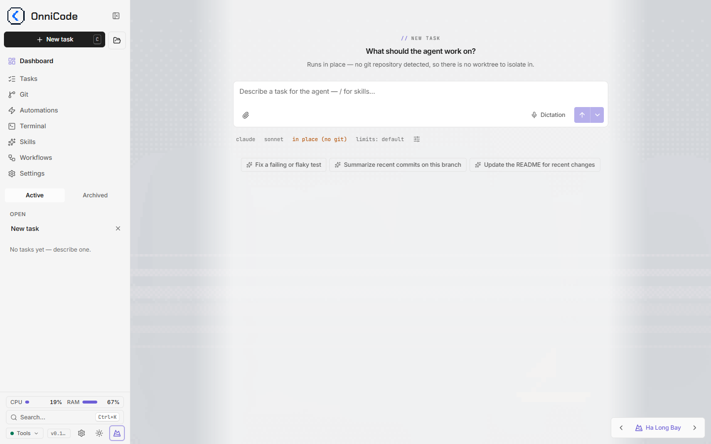
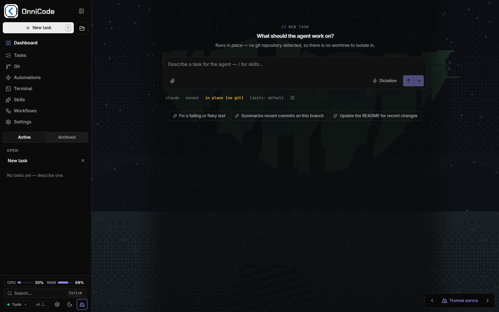

## 1. Hiện trạng v1 thật — kỹ thuật tốt, thẩm mỹ chưa đạt

Baseline 22/11/2026: [R1](research/R1-upstream.md), [R2](research/R2-craft.md), [R3](research/R3-audit-scenes.md), [R4](research/R4-audit-theme-ui.md), [biên bản v1 §12](11-verification-status.md). Đây là hiện trạng trước sửa, không phải kết quả v2.

### 1.1 Điểm mạnh và điểm yếu

| Thành phần v1 | Đã có | Giới hạn thực |
| --- | --- | --- |
| Engine indexed | `base → indexed → RGBA`, ≤32 index; diện tích ≤129.600 art pixel, mỗi cạnh ≤480; seeded, PNG Node | Copy/convert toàn ảnh mỗi frame; nhiều reflection quét 32–38% buffer. Cycling không làm toàn pipeline O(32) ([R2 §1,4](research/R2-craft.md), [R3](research/R3-audit-scenes.md)). |
| Host/loop | Worker OffscreenCanvas, main fallback; một bitmap in-flight + ACK/close; 12 fps, trung bình 30 mẫu >8 ms ⇒ 12→6→0; hidden/reduced-motion/motion-off dừng động | Chưa profiling v2/main+worker+present; không bỏ phanh để đạt số hiệu ứng ([R2](research/R2-craft.md)). |
| Màu/thời điểm | Dawn/day/dusk/night, bank bóng/phản chiếu; auto theo giờ máy | Chưa author riêng palette light/dark; ceiling auto bao tất cả giờ, bảo thủ hơn màu hiện thấy ([R4 §3](research/R4-audit-theme-ui.md)). |
| Shell/UI | Một backdrop cột phải, sidebar đặc; Settings/popover/⌘K, lưu global optional; tắt không canvas trong kiểm tra v1 | LUT clamp toàn cảnh + scrim toàn cột; chrome nền 88%, horizon 45% đáy bị dock che. Kiểm foreground + muted chưa bao soft/cú pháp/status ([R4](research/R4-audit-theme-ui.md)). |
| 8 cảnh | Có địa danh, lớp địa hình, sprite, motion; Phú Quốc/Matterhorn có silhouette khá hơn | Khối ít shade, sọc/dither lặp, sprite quá nhỏ. Tromsø gọi `paintAurora` chỉ ở build: **aurora tĩnh**, nước mới động. Không ghi “v1 không có lớp/motion” ([R1 §4](research/R1-upstream.md), [R3](research/R3-audit-scenes.md)). |
| Công cụ | Sheet 3 cỡ × 4 giờ × 2 theme, golden hash, test tương phản | Sheet không qua ceiling/CSS/chrome; popover còn placeholder. Hash xanh không chứng minh UI đẹp ([R4 §2](research/R4-audit-theme-ui.md), [11](11-verification-status.md)). |

### 1.2 Dữ liệu đo, tính toán và giới hạn

[R4 §3.3](research/R4-audit-theme-ui.md) đã chạy hàm hiện có với `s=.7`, `time:auto`, Node v24.21.0; **không lấy mẫu pixel screenshot, không benchmark browser**. C = trần LUT, A = alpha scrim. Giữa cột xấp xỉ `min(s,C)×(1−A)=C²/s` trước horizon/chrome. Đây là hệ số độ lệch màu sRGB, không phải % luminance/cảm nhận; CSS oklab và làm tròn byte giới hạn độ chính xác.

| Cảnh / theme | C | A | Hệ số giữa cột |
| --- | ---: | ---: | ---: |
| Hạ Long / sáng | 17,83% | 74,53% | 4,54% |
| Hạ Long / tối | 23,35% | 66,64% | 7,79% |
| Sahara / sáng | 18,05% | 74,21% | 4,66% |
| Sahara / tối | 21,75% | 68,92% | 6,76% |
| Tromsø / sáng | 17,10% | 75,57% | 4,18% |
| Tromsø / tối | 23,01% | 67,13% | 7,56% |

Tám cảnh: sáng **4,18–4,69%**, tối **5,99–7,79%**. Sahara sáng tăng slider .7→1 còn giảm giữa cột 4,66→3,26%; tăng default đơn thuần không chữa lỗi. Horizon chỉ đạt alpha đầy đủ ở 20,25% đáy shell trước dock ([R4 §3.4](research/R4-audit-theme-ui.md)).

| Chứng cứ kiểm tra v1 | Kết quả trong biên bản | Giới hạn |
| --- | --- | --- |
| Khung lõi | [11 §11](11-verification-status.md) ghi ≈1,2 ms @480×270 | Thiếu trace/máy/p95 tại đây; không bao present/compositor, không chứng minh v2 ≤2 ms. |
| Kỹ thuật | [11 §12](11-verification-status.md): build/check:pack, web typecheck đạt; 9 file/58 test liên quan đạt; sheet/hash khớp | Kế thừa biên bản, không chạy lại lượt viết kế hoạch. Full npm test, test:unit, test:package chưa chạy. |
| E2E | Canvas qua sau lần chờ đầu; sau lỗi user-bubble; spec thread đối chứng lỗi tương tự | **Chưa xanh**, chỉ phủ Hạ Long; chưa chứng minh fixture đã sửa. `test-env-up.sh` gặp shim Python Store ([11 §12](11-verification-status.md)). |

### 1.3 Điểm mỹ thuật baseline

Điểm 1–5 của [R3](research/R3-audit-scenes.md), không phải chủ sản phẩm đã ký. Thứ tự: **bố cục / chiều sâu / màu / chi tiết / chuyển động**.

| Cảnh | Điểm R3 | Hướng v2 |
| --- | --- | --- |
| Hạ Long | 3 / 2 / 3 / 2 / 2 | Vẽ lại mặt khối karst, đảo tiền cảnh, thuyền rõ, nước chia patch |
| Phú Quốc | 4 / 3 / 4 / 3 / 3 | Giữ ý tưởng, chỉnh lớn dừa/rim/foam/đường glint |
| Mù Cang Chải | 2 / 2 / 3 / 2 / 2 | Vẽ lại thung lũng, terrace khác tỷ lệ, nhà/cây làm mốc |
| Fansipan | 3 / 3 / 4 / 2 / 3 | Vẽ lại peak/ridge, mây có thể tích và ánh ngược |
| Matterhorn | 4 / 3 / 3 / 3 / 3 | Giữ ý tưởng, chỉnh lớn mặt núi/cây/hồ phản chiếu |
| Sahara | 3 / 2 / 3 / 2 / 1 | Vẽ lại slip-face, caravan/footprint, bụi theo crest |
| Santorini | 2 / 2 / 3 / 2 / 1 | Bỏ v2, cảnh thay chốt ở [03](03-scene-set.md) |
| Tromsø | 3 / 2 / 3 / 2 / 3 | Vẽ lại aurora động, ridge/cabin/phản quang; điểm motion không chứng minh aurora động |

### 1.4 Ảnh evidence v1

Đã xem hai ảnh dưới khi viết lại: Hạ Long sáng gần hoà nền; Tromsø tối có rèm khối chìm. Ảnh có sẵn, không chụp mới; thiếu sidecar nên **không khẳng định setting 70% từ PNG**. Số .7 ở §1.2 là đầu vào phép tính R4.

Đối chiếu: [chat sáng](evidence/ui/chat-light-sahara.png), [chat tối](evidence/ui/chat-dark-sahara.png), [tắt cảnh](evidence/ui/off-chat-light.png), [sheet Hạ Long](evidence/contact-sheets/scene-vn-halong.png), [sheet Santorini](evidence/contact-sheets/scene-world-santorini.png), [toàn bộ UI](evidence/ui/), [contact sheet](evidence/contact-sheets/). Sheet t=0, seed=42, visibility=.7 bỏ composite app; ảnh tĩnh không chứng minh motion. V2 phải có ảnh kèm metadata và chuỗi thời gian, so cạnh upstream ([R1 §3,5](research/R1-upstream.md)).

---
[← Mục lục](README.md)
