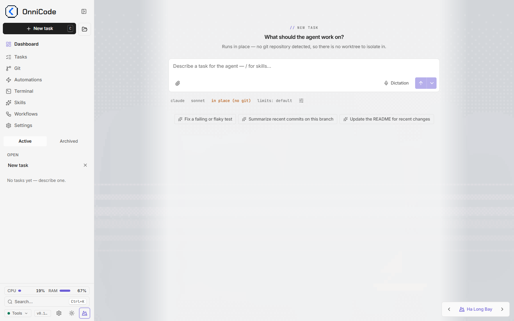
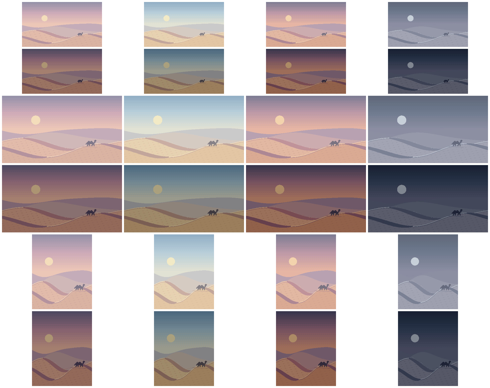

# R2 — Nghề làm cảnh pixel-art và hoạt ảnh nền

Ngày khảo sát: **22-11-2026**. Phạm vi: nghiên cứu và đề xuất cho OnniCode; chưa thay renderer, chưa đo hiệu năng và chưa nghiệm thu một bản tranh v2. Đọc cùng [quyết định nền](../00-decisions.md) và [brief nghiên cứu](_BRIEF.md).

**Khuyến nghị:** nâng chất lượng hình khối, palette và phân lớp trước; giữ **Canvas2D indexed + palette cycling**, bổ sung vài sprite vẽ tay nhỏ. WebGL là phương án thử sau nếu profiling chỉ ra chi phí chuyển/present pixel hoặc nhu cầu ánh sáng động vượt khả năng bản 2D. Mục tiêu thẩm mỹ không đồng nghĩa với tăng mật độ hạt hay chuyển mọi thứ lên 60 fps.

## 1. Bằng chứng và giới hạn kết luận

Quy ước xuyên suốt:

- **Đã đọc — nguồn**: nội dung được nhà phát triển, hoạ sĩ hoặc tài liệu API xác nhận; dẫn `[S#]` đến URL cụ thể ở cuối.
- **Đã đọc — repo / đã xem — ảnh**: hiện trạng trong checkout này, liên kết đến file tương ứng.
- **Đề xuất R2**: thiết kế áp dụng riêng cho OnniCode. Mọi tốc độ, số hạt, tỷ lệ và ngân sách bên dưới là điểm khởi đầu cần đo/duyệt, **không phải benchmark**, không gán cho game tham khảo.

### 1.1 Những gì engine đã có

| Bằng chứng nội bộ | Hệ quả khi nâng cấp |
| --- | --- |
| [`renderer.ts`](../../../../packages/web/src/lib/scenery/engine/renderer.ts): `base`, `indexed` là `Uint8Array`, `rgba` là `Uint32Array`; mỗi frame copy `base`, gọi `scene.frame`, rồi `indexedToRgba` toàn ảnh. Giới hạn diện tích 480×270 art pixels, mỗi chiều ≤480. | Cập nhật vài màu LUT rẻ, nhưng xuất RGBA vẫn O(W×H), không phải toàn pipeline O(32). Không tăng độ phân giải để bù tranh phẳng. |
| [`palette.ts`](../../../../packages/web/src/lib/scenery/engine/palette.ts): 1–32 màu, LUT 32 mục; palette ngắn được mở rộng, nửa trên mặc định có thể thành màu bóng. Bốn mốc `night/dawn/day/dusk`, nội suy RGB. | Chưa có nhóm cycling mang ngữ nghĩa. Không tuỳ tiện chiếm slot 16–31: palette cũ có thể dựa vào màu bóng được sinh tự động. |
| [`loop.ts`](../../../../packages/web/src/lib/scenery/engine/loop.ts): mặc định 12 fps; sau 30 mẫu, chi phí trung bình >8 ms hạ 12→6→0. `hidden`, `motion`, `reducedMotion` chặn hoạt ảnh. | Không được mô tả v1 là 60 fps. 60 fps cần thiết kế lại chính sách lịch/phanh, không chỉ thay hằng số. |
| [`worker-runtime.ts`](../../../../packages/web/src/lib/scenery/engine/worker-runtime.ts), [`host.ts`](../../../../packages/web/src/lib/scenery/engine/host.ts): OffscreenCanvas trong worker, một bitmap đang bay, ACK `presented`, main đóng bitmap; lỗi worker có đường lùi main. | Giữ chống dồn hàng, giải phóng tài nguyên và đường lùi. OffscreenCanvas không làm biến mất tổng CPU; nó chuyển công việc khỏi main. |
| [`dither.ts`](../../../../packages/web/src/lib/scenery/engine/dither.ts): Bayer 4×4/8×8; [`sprite.ts`](../../../../packages/web/src/lib/scenery/engine/sprite.ts): sprite indexed, `-1` trong suốt. | Có thể dùng lại primitive; không cần thư viện scene graph chỉ để thêm sương, chim hay đom đóm. |
| [`halong.ts`](../../../../packages/web/src/lib/scenery/scenes/vn/halong.ts): đã có lớp núi, sương, phản chiếu và thuyền nhấp nhô; [`sahara.ts`](../../../../packages/web/src/lib/scenery/scenes/world/sahara.ts): đã có mép sáng cồn cát, lạc đà tĩnh và bụi động. | Vấn đề là chất lượng/phân bố hiệu ứng, không phải v1 hoàn toàn không có chúng. Cần so A/B cụ thể thay vì tích thêm hiệu ứng trùng chức năng. |

### 1.2 Quan sát ảnh đã lưu

Đã xem trực tiếp hai ảnh sau; đây là chứng cứ v1 có sẵn, không phải ảnh mới chụp trong lượt R2:



**Quan sát:** UI sáng làm các cụm núi/thuyền gần chìm vào nền xám; thông tin địa danh khó đọc bằng hình. Từ ảnh đơn lẻ không thể quy nguyên nhân chính xác cho riêng scrim hoặc palette. Code [`scene-backdrop.tsx`](../../../../packages/web/src/components/scene-backdrop.tsx) và [`index.css`](../../../../packages/web/src/styles/index.css) cho thấy có tone mapping, trần visibility, scrim theo cột đọc và mask horizon; cần đo đầu ra sau toàn bộ phép ghép trước khi sửa.



**Quan sát:** silhouette lạc đà, mặt sáng/tối và lớp cồn cát đã nhận ra; vùng trời có pattern dither rất đều, các khối lớn vẫn tương đối đơn giản. **Suy luận R2:** thêm phân cấp value và cluster vật liệu có thể cải thiện mạnh hơn tăng số hạt. Contact sheet tĩnh không chứng minh hoạt ảnh mượt hay CPU thấp.

## 2. Học gì từ các nguồn thật

1. **Mark Ferrari — GDC 2016.** Abstract chính thức mô tả color cycling/palette shifting tạo hoạt ảnh nền phức tạp mà không dùng frame-animation [S1]. Bản **Canvas Cycle** do Joseph Huckaby thực hiện chuyển engine cycling 8-bit ra HTML5 Canvas 32-bit; phần giới thiệu ghi tranh do Ferrari vẽ [S2], demo có chế độ Standard/Blend [S3]. **Suy luận áp dụng:** hiệu quả đến từ cách bố trí index theo dòng chảy ngay trong tranh; đảo màu một mảng nước tô phẳng chỉ tạo nhấp nháy.
2. **Octopath Traveler — Acquire/Square Enix qua Unreal Engine.** Phỏng vấn xác nhận phối pixel 2D với môi trường 3D, và thêm point light đồng thời VFX để tạo bóng nhân vật [S4]. **Suy luận áp dụng:** mượn quan hệ nguồn sáng–mặt nhận sáng–bóng tiếp xúc; không suy ra rằng cần UE, 3D toàn cảnh, depth of field hoặc shadow map cho nền cockpit.
3. **Eastward — Pixpil/Chucklefish.** Trang media chính thức ghi phối artwork retro-pixel với hệ thống chiếu sáng 3D [S5]. **Suy luận áp dụng:** một lớp ánh sáng khí quyển có chủ đích có thể nâng artwork đẹp; nguồn này không xác nhận normal map cụ thể, số pass, framebuffer hay shader code. R2 không khẳng định các chi tiết đó.
4. **Raymond Schlitter / SLYNYRD.** Hướng dẫn palette giải thích hue-shift thay vì chỉ tăng sáng [S6]; bài landscape mô tả vật xa nhận màu khí quyển, giảm tương phản và số màu [S7]; bài parallax cảnh báo chuyển động không cứu được tranh vốn thiếu chiều sâu [S8]. **Suy luận áp dụng:** duyệt tranh tĩnh trước hoạt ảnh.
5. **Pixel Parmesan.** Phân biệt fill dither và transitional dither; cảnh báo noise, mất nét hình khối và sprite quá nhỏ để dither [S9]. **Suy luận áp dụng:** Bayer là công cụ có mask vật liệu, không phải bộ lọc phủ toàn cảnh.

Các trang và abstract trên đã được đọc bằng web; không tuyên bố đã xem trọn video GDC hay đo demo trên máy đích. Không dùng tên Eric Barone làm thẩm quyền thay cho nguồn xác thực. Không chép mã/tài sản từ bất cứ ví dụ nào.

## 3. Danh mục theo hiệu quả thị giác / chi phí

**Thang đánh giá do R2 đề xuất**, tương đối giữa kỹ thuật cho nền cockpit: hiệu quả 1–5; runtime thấp/vừa/cao; công art/code thấp/vừa/cao. Không phải điểm do nguồn công bố. `N=W×H`, `K≤32` màu, `P` hạt, `A` diện tích hiệu ứng, `L` lớp. Điểm cao ưu tiên làm trước; không có nghĩa mọi cảnh bật tất cả kỹ thuật.

| Ưu tiên | Kỹ thuật | Hiệu quả | Runtime tăng thêm | Công art / code | Bài áp dụng |
| --- | --- | --- | --- | --- | --- |
| 1 | Palette ramp, hue-shift, value grouping | 5 | Thấp; chủ yếu khi đổi LUT | Cao / thấp | Tất cả, sáng và tối |
| 2 | Phân lớp khí quyển + silhouette | 5 | Thấp nếu bake | Cao / vừa | Hạ Long, Fansipan, Sahara |
| 3 | Ánh sáng có hướng + rim + bóng tiếp xúc | 5 | Thấp nếu bake | Cao / vừa | Cát, núi tuyết, nhà trắng |
| 4 | Nước: phase index + palette cycling | 5 ở cảnh nước | Thấp phần palette; RGBA vẫn O(N) | Vừa / vừa | Hạ Long, Phú Quốc, Santorini |
| 5 | Dithering theo vật liệu, giảm noise | 4 | Thấp nếu bake | Vừa / thấp | Trời, sương, cát |
| 6 | Sprite điểm nhấn, frame vẽ tay | 4 | Thấp, theo diện tích sprite | Vừa–cao / thấp | Chim, thuyền, lạc đà |
| 7 | Mây/sương thành lớp có chiều sâu | 4 | Vừa, O(A) | Vừa / vừa | Fansipan, Hạ Long, Tromsø |
| 8 | Parallax biên độ nhỏ | 4 | Vừa, O(LN) nếu ghép thô | Vừa / vừa | Lớp gần/xa đã tách tốt |
| 9 | Ngày–đêm theo ngữ nghĩa | 4 | Thấp khi cập nhật chậm | Cao / vừa | Tất cả |
| 10 | Sao, đom đóm, bụi thưa | 3 | Thấp, O(P) | Thấp / vừa | Đêm, rừng, sa mạc |
| 11 | Mưa/tuyết theo lớp | 3, phụ thuộc cảnh | Thấp–vừa, O(P×độ dài nét) | Vừa / vừa | Fansipan, Tromsø |
| 12 | Bloom cục bộ giả lập | 2–3 | Thấp nếu bake; cao nếu blur toàn ảnh | Vừa / vừa | Đèn, mặt trời, phản quang |
| 13 | CRT, scanline, vignette | 1–2 | Thấp–vừa; thêm pass | Thấp / vừa | Chỉ thử sau cùng |

### 3.1 Palette ramp và hue-shift

**Cơ sở:** [S6]. **Đề xuất R2:** mỗi vật liệu có 3–5 bậc rõ nghĩa `shadow → body → lit → glint`, dùng chung màu xa khi phù hợp. Ví dụ ramp cát hoàng hôn thử `#423650 → #895368 → #C77C60 → #EDB879`; bóng tím mát, thân đất đỏ, sáng vàng ấm. Đây là swatch thử, chưa qua kiểm tra tương phản UI.

- Cài: tạo bảng role→index theo cảnh; giữ role ổn định ở cả bốn keyframe. `build` ghi index theo mặt khối; `setPalette` chỉ đổi màu. Khởi đầu khoảng 5–15° hue mỗi bước, sửa bằng mắt theo nguồn sáng; không biến con số thành luật phổ quát.
- Tách palette **light** và **dark** theo value grouping/độ bão hoà; `TimeOfDay` là trục thời tiết/giờ, theme là trục trình bày khác. Nền sáng cần silhouette trung/cận cảnh đậm vừa đủ và highlight tiết chế; nền tối cần vùng bóng còn phân biệt được, tránh neon toàn cảnh.
- Chi phí: gần như không thêm công mỗi frame khi palette đứng yên. Công chính ở art và kiểm tra palette sau tone mapping. Nhược: hue-shift quá mạnh làm chất liệu đổi loại; brightness HSB không đồng nghĩa luminance cảm nhận.
- Duyệt: xem bản grayscale để kiểm tra 3 khối lớn gần/trung/xa, rồi xem lại màu trong UI ở cùng visibility. Không phê duyệt chỉ vì standalone PNG rực hơn.

### 3.2 Chiều sâu và ánh sáng khí quyển

**Cơ sở:** [S7], [S13]. **Đề xuất R2:** 3 lớp địa hình + một lớp tiền cảnh chọn lọc, khác nhau cả silhouette, mức chi tiết và contrast. Không xếp bốn bản sao cùng ridge với bốn màu.

- Cài indexed: bake `depthMask` hoặc biết depth ngay khi dựng lớp; gán ramp xa đã pha màu trời. Thử hệ số haze gần/trung/xa `0.08/0.28/0.55`; tính màu ở palette/build, không `mixColor` trên mọi pixel mỗi frame. Cùng một index không thể vừa là cây gần vừa là cây xa nếu cần haze khác nhau: tách role.
- Địa hình xa: cluster lớn, ít khe nứt; gần: cạnh rõ, bóng có mặt, vài chi tiết vật liệu. Hạ Long nên có chân đảo bị sương che xen kẽ, tránh kẻ dải sương ngang liên tục xuyên mọi đảo như lớp rèm.
- Chi phí: bake O(N) khi build/resize, không thêm pass thường xuyên. Một depth byte/pixel tối đa 129.600 byte nếu thực sự cần; bỏ nếu thứ tự lớp đã đủ.
- Nhược: haze đồng màu + scrim UI dễ cộng dồn thành ảnh bạc. Duyệt light/dark độc lập; không dùng haze để hợp thức hoá mất silhouette cận cảnh.

### 3.3 Ánh sáng có hướng, rim light và bóng tiếp xúc

**Cơ sở:** quan hệ ánh sáng/bóng trong [S4], khí quyển trong [S5], mood ánh sáng trong [S7]. **Đề xuất R2:** chọn một hướng sáng thống nhất, bake phần lớn ánh sáng vào index.

- Núi/cồn cát: lấy chênh lệch ridge `h[x+1]-h[x-1]` làm xấp xỉ hướng mặt; chọn `shadow/body/lit`. Không cần tạo normal map đầy đủ để phân biệt hai mặt cát.
- Rim: chỉ tô 1 art pixel trên một phần mép hướng nguồn sáng; thử 10–25% chiều dài silhouette, có đứt nhịp. Không viền sáng kín quanh núi; đó thành outline, mất cảm giác ánh sáng.
- Bóng tiếp xúc: cụm 2–8 pixel dưới chân lạc đà/chân nhà; thuyền có bóng/phản chiếu ngắn và wake theo hướng chuyển động. Bóng động nhỏ vẽ lại trong cùng vùng bẩn với sprite.
- Đèn đêm: precompute `lightLut[4][32]` cho bốn mức cường độ và mask vòng sáng nhỏ. Đổi index qua LUT, tránh alpha floating-point mỗi pixel. Chi phí mask tĩnh ở build; đèn động O(A). Nhược: palette 32 màu không đủ cho mọi vật liệu × mọi mức sáng; chỉ relight các role được duyệt.

### 3.4 Nước lung linh bằng palette cycling và LUT

**Cơ sở:** Ferrari/Huckaby [S1–S3]. **Đề xuất R2:** thay hạt sáng ngẫu nhiên bằng đường phản quang có cấu trúc, vẫn giữ mép đảo/bờ.

1. Trong build, dành **4–6 index riêng** cho các pha nước. Vẽ cụm nét ngang dài ngắn theo phối cảnh; bề rộng vệt sáng tăng dần về phía người xem. Index của cụm thay đổi theo vị trí dọc dòng chảy, không random hoàn toàn.
2. Dùng `phase=floor(t*6)%m` cho nhịp thử 6 bước/giây. Với mỗi role nước, tra màu ở `(j+phase)%m`. Giữ index tĩnh; chỉ thay LUT của nhóm đó. Một nhóm glint khác có thể chạy 4 bước/giây, nhưng không chiếm thêm slot nếu không đủ.
3. Chế độ blend nội suy hai màu palette kế nhau theo phần lẻ của pha; nội suy diễn ra trên ≤6 mục, không blur không gian. Kiểm tra xem mức chuyển có làm tranh nhợt đi không.
4. Màu đêm/ngày được tính trước cycling: `keyframe palette → role cycle → tone map → packRgba → indexedToRgba`. Không xoay cả LUT, không để index cát/đèn dùng chung nhóm nước.

Mã phác thảo TS cho renderer tương lai, **không phải API đang có**:

```ts
// waterSlots và workingPalette được cấp phát một lần; mọi slot đều < 32.
const phase = t * 6;
const step = Math.floor(phase);
const blend = phase - step;
for (let j = 0; j < waterSlots.length; j++) {
  const a = waterSlots[(j + step) % waterSlots.length]!;
  const b = waterSlots[(j + step + 1) % waterSlots.length]!;
  workingPalette[waterSlots[j]!] = mixColor(timePalette[a]!, timePalette[b]!, blend);
}
// Sau đó áp tone mapping và pack vào LUT có sẵn, không tạo mảng mới/frame.
```

Chi phí cập nhật màu O(m); pipeline hiện tại vẫn copy base, convert và present O(N). Muốn cycling không còn đi qua CPU mỗi pixel phải sang phương án WebGL. `setPalette` hiện tạo mảng mới nên không gọi mỗi frame để giả lập đoạn trên; cần một đường cập nhật LUT tái sử dụng.

Nếu cần biến dạng phản chiếu: chỉ lấy pixel từ ảnh phản chiếu nguồn bất biến, dịch ngang từng hàng ±1–2 art pixels ở vùng nước, có water mask; không lấy từ output frame trước gây phản hồi. Nhược: cycling không tạo chuyển động hình học cho thuyền; phải tách sprite/wake.

### 3.5 Dithering có chủ đích và cluster vật liệu

**Cơ sở:** [S9]. **Đề xuất R2:** giữ Bayer 4×4 cho dải chuyển trời/sương hẹp; thử tỷ lệ 25/50/75% ở ranh giới các bậc gần màu. Không phủ cả bầu trời bằng cặp màu tương phản cao.

- Cài: `materialMask` giới hạn nơi gọi `ctx.dither`; với địa hình tĩnh, pattern neo theo toạ độ thế giới/lớp. Không đổi seed theo frame, không temporal dither trên chữ/nền đọc. Cát dùng cụm nét ngắn có hướng gió, đá dùng vết nứt theo mặt, mây dùng cluster lồi/lõm riêng.
- Khi lớp parallax dịch, dịch cả pattern theo lớp; nếu pattern đứng theo màn hình còn vật thể chạy sẽ thấy texture trượt. Giữ sprite chim/thuyền nhỏ thành mảng sạch.
- Chi phí: bake vào base, runtime không thêm. Nhược: dither + integer upscale + mask CSS có thể thành lưới chói/moire; xem ở kích thước app thật, không chỉ 1×.
- A/B bắt buộc: trời solid theo 4 bậc so với trời dither hạn chế, cùng palette và scale. Chọn bản đọc hình khối tốt hơn.

### 3.6 Sprite động nhỏ: chim, thuyền, lạc đà

**Cơ sở:** thực hành ghép animation loop và sprite nhỏ trong [S8]; dữ liệu indexed của repo đã hỗ trợ sprite. **Đề xuất R2:** tối đa 1 chủ thể kể chuyện + 1 chuyển động phụ trong mỗi bố cục.

| Sprite | Kích thước/nhịp thử (art pixels) | Cách cài indexed | Rủi ro |
| --- | --- | --- | --- |
| Chim | 8×5, 3–4 pose ở 5–7 fps; một đàn 2–3 con thưa | `pose=floor(t*6+phase)%4`, vị trí theo đường cong bake thành waypoint, vẽ silhouette tương phản vừa | Quá nhỏ thành chấm, quá nhanh hút mắt; tránh bay xuyên vùng soạn thảo |
| Thuyền | 16×10 đến 24×16; dịch chậm, bob ±1 px | Thân cố định, 2 pose buồm; mask water để wake 2–4 nét phía sau; bỏ sprite khỏi base nếu sprite sẽ di chuyển | Lật thuyền không đồng bộ wake/ánh sáng; thuyền cũ còn trong base gây bóng ma |
| Lạc đà | khoảng 24×14, 4 pose chân ở 3–5 fps; thân bob 0–1 px | Atlas indexed decode một lần, chân tiếp xúc ridge và bóng chạy cùng; thân tiến 0.3–0.6 px/s | Trượt chân, đi sai mặt cồn; nếu chưa vẽ được pose tốt thì giữ tĩnh, chỉ chuyển đuôi |

Không đổi pose bằng RNG mỗi frame. Dùng thời gian tuyệt đối, seed và phase cố định; vẽ vào pixel nguyên. Bộ 4 pose 24×14 indexed cần 1.344 byte pixel thô, chưa gồm metadata; chi phí art cao hơn runtime. Sprite đứng yên vẫn cần pose tĩnh đẹp khi reduced-motion.

### 3.7 Mây và sương động

**Cơ sở:** hình khối mây, phối cảnh [S7], phân lớp [S8]; Eastward chỉ xác nhận hướng chiếu sáng tổng quát [S5]. **Đề xuất R2:** 2 nhóm mây khác scale và một dải sương ngắt đoạn theo địa hình.

- Mây: bake tile indexed có vùng trong suốt; sáng ở đỉnh, bóng ở bụng, không dùng toàn đĩa tròn đồng cỡ. Thử trôi `0.15/0.4 px/s`, offset theo `floor(t*v)`; tile overscan để không bật seam ở mép.
- Sương: atlas noise nhỏ tạo ở build, sample bằng offset chậm; gate theo độ cao chân núi và depth. Tạo mask thưa, chuyển index nền qua `fogLut[amount][index]`, không ghi một màu trắng kín. Thử dải cao 8–20 px, cập nhật 2–4 fps, pha khác nhau giữa các dải.
- Ghép đúng thứ tự: trời → núi xa → sương xa → núi giữa → sương giữa → núi gần → sprite. Sương trước nền khác với haze bake vào palette.
- Chi phí O(A), tăng theo bề rộng dải; không gọi FBM nhiều octave cho cả màn hình mỗi frame. Nhược: mask thưa dễ lộ dither chuyển động; nếu không ổn thì giữ sương tĩnh, chỉ cho mây trôi.

### 3.8 Parallax có giới hạn

**Cơ sở:** [S8]. **Đề xuất R2:** 3–4 lớp indexed được build/cache riêng, transparency dùng sentinel 255 ở buffer lớp, khác với index hợp lệ 0–31. Dùng bounds/runs để không quét pixel trong suốt toàn lớp.

- Với scroll, thử hệ số xa/trung/gần `0.02/0.05/0.10`, nhưng clamp offset đầu ra chỉ ±1/±3/±6 art pixels; pointer không phải yêu cầu v1. Không có nguồn input thì bức tranh vẫn đẹp khi đứng yên, chỉ mây tự trôi.
- Giữ offset float trong state nhưng **làm tròn khi sample**; thừa nhận chuyển 1 art pixel sẽ có bước ở tốc độ thấp. Không gọi “mượt subpixel” khi chỉ thay lịch lên 60 fps. Có thể thử dịch lớp ở compositor riêng để mượt hơn, nhưng phải A/B độ sắc nét; đó là biến thể kiến trúc cần duyệt.
- Layer động phải overscan ít nhất bằng offset cực đại, có quy tắc crop/focus riêng cho màn hẹp. Không dịch cả khung chứa núi điểm nhấn ra khỏi vùng nhìn.
- Chi phí ghép thô O(LN), RAM mỗi lớp đầy đủ tối đa 129.600 byte. 4 lớp là 518.400 byte pixel thô; chưa gồm base/RGBA/mask. Nhược: tách layer tăng công art và dễ lộ vùng trống; không có chiều sâu tĩnh thì parallax không cứu được tranh.

### 3.9 Cycle ngày–đêm

**Cơ sở:** cơ chế palette shifting [S1], mood ánh sáng [S7]; repo đã có nội suy bốn mốc. **Đề xuất R2:** giữ bốn mốc nhưng duyệt **ngữ nghĩa** từng role, không chỉ phủ màu tím lên ban đêm.

- Trời, mây, sương, đèn, phản quang dùng cùng timeline; role sao/đèn mờ dần theo cửa sổ thời gian riêng. Mặt trời/mặt trăng di chuyển cần layer/mask, không thể đạt chỉ bằng đổi palette.
- Chế độ `auto` vẫn theo giờ máy như hiện tại; cập nhật palette khi bucket phút thay đổi là đủ cho đồng hồ thật. Preview time-lapse chỉ là công cụ duyệt, không mặc định cho cảnh liên tục bình minh/hoàng hôn vài phút một vòng.
- Nếu RGB interpolation tạo điểm giữa xám đục, author thêm keyframe hoặc bake bảng nội suy offline theo không gian màu phù hợp; không chuyển HSL/OKLab trên từng pixel mỗi frame. Theme sáng/tối vẫn kiểm tra riêng với cùng giờ.
- Chi phí O(K) mỗi lần đổi palette + xuất ảnh khi cần. Nhược: thay ngữ nghĩa index giữa keyframe gây vật thể nhấp nháy; đóng băng phase khi motion tắt, nhưng vẫn cho đổi palette tĩnh theo tuỳ chọn thời gian.

### 3.10 Sao nhấp nháy, đom đóm và bụi

**Cơ sở:** nguyên tắc palette animation [S1] và giới hạn nền phải phục vụ nội dung [S13]. Toàn bộ recipe sau là **đề xuất R2**, không khẳng định là thuật toán của Ferrari/Eastward.

| Hiệu ứng | Recipe thử cho khung tối đa 480×270 | Cài đặt và chi phí | Khi không nên dùng |
| --- | --- | --- | --- |
| Sao | 20–40 điểm tĩnh; chỉ 4–8 điểm đổi 2 mức sáng, chu kỳ 3–7 giây lệch pha | Vị trí tạo một lần; chỉ trong sky mask; intensity sin chậm lượng tử hoá, O(P). Không bật/tắt cùng lúc | Trời ban ngày, vùng nhiều chữ, sao bị trôi như tuyết |
| Đom đóm | 6–12 hạt, đường ellipse 2–5 px, chu kỳ sáng 2–5 giây | Core 1 px + halo bake nhỏ; typed-array pool, không cấp phát từng frame; O(P) cộng halo | Sahara/địa hình không hợp cảnh; glow phủ chủ thể |
| Bụi | 12–30 nét ngắn, trôi 1–4 px/s; theo vùng cồn hoặc vùng nắng | `x=wrap(x0+vx*t)`, `y=y0+sin(...)`; che bởi foreground mask; O(P) | Phủ bụi đồng đều khắp trời, hạt sáng hơn điểm nhấn |

Giữ phase bằng seeded hash từ id, không `Math.random()` trong frame. Không gọi sao chớp là “nhấp nháy đẹp” nếu tần số/contrast gây xao nhãng; reduced-motion phải có bản tĩnh.

### 3.11 Mưa và tuyết

**Cơ sở:** recipe R2 trên mô hình layer [S8], primitive/caching [S10]. **Đề xuất:** dùng pool hữu hạn, spawn trong vùng cảnh trống, có mask độ sâu.

- Mưa: 35–70 nét, 2 lớp; xa dài 2–3 px/tốc độ 15–25 px/s, gần dài 4–7 px/tốc độ 30–50 px/s. Góc cùng gió, splash 2 pose trên mặt nước/đất ở 3–5 điểm. Ở lịch 12 fps nét gần nhảy 2.5–4.2 px/frame: nên rút tốc độ/đổi sang loop mưa ngắn, không mặc định tuyên bố mượt.
- Tuyết: 20–40 hạt, 2 lớp; xa 1 px và 2–4 px/s, gần 1–2 px và 5–9 px/s, gió sin chậm. Không dùng vòng tròn alpha lớn làm mất chất pixel.
- Chỉ lấy t/dt có clamp; khi tab quay lại không bù hàng nghìn bước spawn. Particle wrap/tái dùng slot, không push/splice object trong vòng nóng.
- Chi phí theo số pixel nét, không số lượng hạt đơn thuần. Nhược: tốc độ lớn ở fps thấp lộ giật, trời sáng làm tuyết khó thấy; giảm mật độ/tăng khác biệt lớp thay vì tăng opacity toàn cảnh. Không cần bật mưa/tuyết trên mọi cảnh hoặc thêm thiết lập bắt buộc.

### 3.12 Bloom nhẹ và CRT

**Cơ sở:** Unity định nghĩa bloom lan sáng từ vùng sáng, có intensity/threshold và lựa chọn giảm chất lượng để giảm chi phí [S14]. Hoạ sĩ SLYNYRD khảo sát CRT như lựa chọn trình bày, không điều kiện để tranh có chiều sâu [S13].

**Đề xuất R2:**

- Canvas indexed: giả glow bằng mask 2–4 vành đã bake, chọn 2–3 màu chuyển ấm quanh đèn/mặt trời. Chỉ animate lõi/glint; không `shadowBlur` và blur CPU toàn N mỗi frame. Chi phí build hoặc O(A) vùng đèn, đổi lại không có bloom vật lý.
- WebGL: chỉ khi cần, tách emissive mask → downsample 1/4 mỗi chiều → blur ngang/dọc → composite. Thử gain 0.05–0.12; con số độc lập với đơn vị Unity. Emissive mask bảo vệ nhà trắng/trời sáng khỏi tự phát quang. Làm trước tone/scrim và kiểm tra đầu ra mới.
- CRT mặc định **tắt** trong đề xuất: nếu thử, chỉ trên canvas cảnh, scanline tĩnh cường độ 0.03–0.06, không lệch RGB/curvature lên UI; grain tĩnh, không sinh noise toàn màn hình mỗi frame. Chi phí thêm pass/texture read; nhược là giảm sắc nét, dễ moire với scale không nguyên và làm sáng/tối chữ bất ngờ nếu áp sai lớp.
- Không dùng bloom/CRT làm tiêu chí nghiệm thu thay cho bố cục, cluster và silhouette. Bản tắt hậu kỳ phải vẫn đẹp.

## 4. Thiết kế để nhẹ CPU và đánh giá 60 fps trung thực

### 4.1 Tách nhịp chuyển động khỏi nhịp trình bày

**Đã đọc:** `requestAnimationFrame` theo nhịp repaint và cần dùng timestamp để tránh tốc độ phụ thuộc refresh rate [S11]. **Đề xuất:** giữ mặc định 12 fps hiện hành khi chưa có số đo. Sprite 4–8 fps, nước 4–8 bước palette/s, mây 2–4 cập nhật/s hoàn toàn có thể cùng tồn tại; chỉ present khi có index/LUT/offset thay đổi.

Một đường 60 fps thử nghiệm có thể dùng rAF ở host, simulation bước cố định 1/30 s, pose lookup từ `t`, phase palette nội suy; nhưng integer motion vẫn có bước. 60 fps chỉ có ích nếu có thay đổi nhìn thấy. Không đặt vòng rAF 60/120/144 Hz để liên tục copy cùng một ảnh. Khi triển khai cần cập nhật kiểu `FrameRate`, scheduler ở cả main/worker và kiểm thử phanh; không bỏ liveness/visibility/reduced-motion để đổi lấy số fps.

### 4.2 Những tối ưu cụ thể

**Cơ sở API:** cache primitive, toạ độ nguyên, tránh shadowBlur và hạn chế đổi state từ [S10]; batch, backbuffer nhỏ, tránh readback đồng bộ và tái dùng texture storage từ [S12]. **Đề xuất R2:**

1. Build địa hình/noise/đường đi/sprite/light mask một lần theo seed, size; không build lại khi chỉ đổi time/theme. Dùng typed-array pool, tái dùng LUT/palette và image buffers.
2. Giữ art resolution hiện tại; chỉ presentation scale theo khung. Không tự nhân resolution theo DPR cho thế giới pixel. Giữ nearest-neighbour và crop/focus được duyệt ở desktop/mobile.
3. Đo riêng `base copy`, `frame`, `indexedToRgba`, `pixels.data.set`, `putImageData`, transfer và main draw; v1 đang có copy RGBA→ImageData. Chỉ tối ưu chỗ đo thấy đắt; thử ImageData view trên buffer nếu tương thích, không giả định copy chắc chắn được loại.
4. Với Canvas2D, giữ một canvas đầu ra và ghép layer ở core; không cần nhiều DOM canvas chỉ vì tutorial gợi ý nhiều layer. Cache vùng/layer, dirty bounds cho sprite. LUT thay đổi có thể làm bẩn toàn vùng nước dù geometry đứng yên; dirty-rect không tự làm cycling miễn phí.
5. Giữ giới hạn một bitmap in-flight + ACK/close. Thử coalesce trước phần render nặng khi main nghẽn; lưu `latest requested t` và dirty state để ACK vẽ trạng thái mới nhất. Không xoá pending change hoặc bitmap cuối khi chuyển sang static.
6. WebGL thử nghiệm: upload index lớp tĩnh một lần, palette texture nhỏ khi đổi; particle/sprite batch một atlas. Nếu vẫn dựng/copy toàn RGBA CPU rồi upload lên GPU mỗi frame thì mới chỉ thêm hậu kỳ, chưa giải quyết chi phí indexed expansion.
7. Có fallback Canvas2D tĩnh/12 fps khi WebGL lỗi/context lost, worker lỗi hoặc ngân sách vượt. Khả năng thiếu chỉ làm cảnh đơn giản hơn; không gây app boot fail, không thêm dependency/config người dùng phải tạo.

### 4.3 Ngân sách và phép tính để lập kế hoạch

**Tính toán R2 từ kích thước code, không phải đo máy:**

- `N=480×270=129.600`. Một RGBA frame = `4N=518.400 byte`; chỉ payload đó ở 60 lần/s là **31.104.000 byte/s ≈29.7 MiB/s**. Đây chưa gồm copy trung gian, upload, compositor, buffer trình điều khiển; không phải số băng thông thực tế.
- Hai indexed buffer + một RGBA buffer = `6N=777.600 byte` phần core; chưa gồm ImageData, atlas, noise, canvas, bitmap. Bốn layer indexed bổ sung `4N=518.400 byte` trước mask/overscan. Không hứa “toàn engine dưới 1 MB”.
- 60 Hz có khoảng **16.67 ms** cho toàn frame UI. Đặt ngưỡng thử cho scenery: core+present CPU p95 ≤2 ms ở desktop tham chiếu, không tạo thêm long task >50 ms trong main; đây là **mục tiêu đề xuất**, chưa được chứng minh. Máy yếu có thể không đạt; ưu tiên cảnh 12 fps đẹp hơn đánh đổi độ phản hồi chat.

**Kế hoạch đo cho worker triển khai sau, không chạy ở lượt nghiên cứu này:** cùng seed/crop, bản off, v1 và v2; 10 giây warm-up + 60 giây ghi trace khi idle, stream chat, cuộn chat; ghi máy/CPU/GPU/browser/WebView, kích thước/DPR, power mode, p50/p95, dropped frames và CPU. Chụp Chrome/Edge Performance hoặc công cụ WebView tương ứng, tách process main/worker/GPU. Đo cả worker và main fallback. Không dùng số fps vẽ rAF để thay số frame thực sự được present.

## 5. Ba phương án kiến trúc nâng cấp

Các phương án là **đề xuất R2**, dùng hiện trạng repo làm điểm xuất phát. Phương án C là thay quy trình tạo tài sản; nó vẫn có thể render bằng A hoặc B, không nhất thiết là backend thứ ba độc lập.

| Tiêu chí | A — Canvas2D indexed + cycling | B — Thêm WebGL shader indexed | C — Layer/sprite-sheet vẽ tay |
| --- | --- | --- | --- |
| Luồng | build indexed layer → ghép index → cập nhật LUT → RGBA → worker present | build/upload index layer → GPU palette lookup/layer composite → hậu kỳ giới hạn → present | author layer/atlas + metadata → decode index một lần → frame lookup/blit → A hoặc B |
| Điểm mạnh | Gần D1/D2 nhất, deterministic, dễ render PNG bằng core không DOM | Cycling/offset có thể không cần đổi ảnh CPU, ánh sáng cục bộ và glow linh hoạt | Kiểm soát cluster, vật liệu, shape language và pose; giảm vẻ thủ tục |
| Điểm yếu | Copy/convert/present vẫn tăng theo N; dynamic lights bị giới hạn palette | Shader, context lost, độ chính xác WebView/GPU và QA phức tạp; thêm backend phải giữ fallback | Công art, source assets, crop đa tỷ lệ; khó đổi góc/địa hình tuỳ ý |
| Tương thích quyết định cũ | Bảo toàn D1/D2 nếu layer API vẫn không DOM | Thay đường xuất RGBA của D2 cho backend GPU; cần chủ thiết kế chấp thuận mở rộng quyết định | Thay/điều chỉnh D8 vốn ưu tiên procedural + vài sprite, nhất là nếu chuyển cả tranh sang ảnh |
| RAM/cost chính | Base + masks + lớp cache, RGBA conversion | Texture/layer/FBO + overdraw + fill-rate; không chỉ số draw calls | Atlas giải nén theo số pose/layer, tài sản có thể lớn dù PNG nhỏ |
| 60 fps | Chưa biết; cần đo tại 480×270 cả host/worker | Có triển vọng giảm CPU nếu giữ dữ liệu tĩnh trên GPU; không bảo đảm GPU/điện năng thấp | Chưa biết; atlas pose rẻ nhưng full-frame animation vẫn tốn bandwidth |
| Khi chọn | Bản nâng cấp đầu, hầu hết cảnh | Có bằng chứng A bị giới hạn present hoặc cần ánh sáng động rõ giá trị | Cảnh cần chất lượng mỹ thuật đặc thù, sprite dễ bị cơ học |

### A. Giữ Canvas2D indexed, thêm layer có ngữ nghĩa

**Đề xuất cấu trúc:** `SceneDef` cũ tiếp tục hoạt động. Scene mới có dữ liệu optional mô tả `layers`, `paletteRoles`, `cycles`, `emitters`; scene không có chúng dùng đường v1. Lõi thuần TS giữ output RGBA và tính tái lập theo seed/time.

- Tạo `paletteRoleLayout` phiên bản riêng cho scene mới; dùng đủ 32 màu một cách tường minh. Ví dụ phân bổ **minh hoạ**, không áp toàn bộ cảnh cũ: trời 0–3, đất/đá 4–11, xa/sương 12–15, nước cycle 16–21, glint 22–23, sprite/đèn 24–27, bóng/accents 28–31. Với Sahara thay nhóm nước bằng ramp cát; không buộc mọi cảnh cùng layout.
- Không thêm `cycles` vào mỗi scene cũ bằng cách đoán index. Validate các nhóm không chồng slot, index <32, mốc palette cùng số mục, sentinel transparency không lọt ra LUT cuối.
- Render order rõ ràng, state cấp phát theo instance. Time/theme update đổi palette; resize/seed mới rebuild geometry. Duy trì ánh sáng bake + ít mask động, không cố giả normal map phức tạp.
- Ship trước một cảnh nước và một cảnh đất; so hình tĩnh, 5 giây loop, UI light/dark. Nếu A đạt mục tiêu thẩm mỹ và chi phí thì dừng, không nâng backend chỉ vì tên kỹ thuật hấp dẫn.

### B. WebGL shader như backend trình bày tuỳ khả năng

**Đề xuất cụ thể:** giữ authoring/build indexed của A. Với WebGL2, texture `R8UI` (`RED_INTEGER`/`UNSIGNED_BYTE`, bảng định dạng [S16]) cho index, `usampler2D`/`texelFetch`; texture RGBA 32×1 cho palette. Filter `NEAREST`, `UNPACK_ALIGNMENT=1` cho hàng index có width lẻ, không mipmaps cho pixel art. Shader áp cycle theo role hoặc nhận palette đã cycle, không làm cả hai. Cài đặt storage/uploads theo [S12]; thiết kế pipeline là đề xuất R2.

- Layer offset là uniform; đổi giờ chỉ upload palette nhỏ. Sprite thay pose bằng atlas rect; water distortion chỉ sample trong water mask. Không readPixels về CPU mỗi frame.
- Giữ 1 pass ghép/palette làm mặc định; chỉ thêm emissive bloom khi nhìn thấy lợi ích, đặt backbuffer/hậu kỳ ở độ phân giải art hoặc mức đo được. Một fullscreen pass 4K vẫn đắt fill-rate dù JS rẻ.
- **Bẫy context:** host hiện lấy context `2d` sớm; không thể sau đó lấy `webgl2` trên cùng canvas đó [S15]. Backend phải được chọn trước tạo context, hoặc thay canvas presentation khi fallback. Không phá khả năng worker lỗi rồi chuyển main. Cân nhắc render WebGL OffscreenCanvas trong worker, vẫn transfer bitmap theo protocol; đo transfer trước khi chọn trình bày trực tiếp.
- Shader dùng màu sau tone mapping/contrast policy, hoặc kiểm lại toàn tập màu sau lighting/bloom. Palette contrast ceiling tính trên màu cũ không bảo đảm hậu kỳ mới an toàn cho chữ. Không hậu kỳ DOM UI.
- Core PNG CPU vẫn là nguồn snapshot tham chiếu, nhưng shader phải có parity test/mức sai số màu và screenshot riêng; CPU PNG không chứng minh đúng đường GPU. Có context lost/compile error phải về A, không treo cảnh.

### C. Layer và sprite-sheet vẽ tay, ưu tiên chất lượng art

**Đề xuất cụ thể:** author nền theo 3–4 lớp, điểm nhấn và 2–6 pose sprite; lưu source do đội tự vẽ, asset xuất kèm metadata bounds/pivot/duration/role index. Cảnh thủ tục vẫn tạo bố cục/resize/seed khi thích hợp; không ép toàn cảnh thành một video/atlas khổng lồ.

- Pipeline xuất indexed asset tại build-time; màu/slot map tường minh, transparency riêng. PNG truecolor không tự trở thành indexed art: phải kiểm màu thuộc palette và reject màu ngoài hợp đồng khi xuất. Không lượng tử hoá mỗi frame.
- Để đổi ngày–đêm/theme vẫn tốt, lưu role/material index, không bake toàn bộ ánh sáng RGBA vào ảnh rồi phủ màu. Chọn phần hand-paint có giá trị nhất: silhouette karst, mặt cát, cây/nhà điểm nhấn, pose lạc đà.
- Overscan, điểm focus và vùng nối được author cho 16:9/4:3/mobile; không kéo giãn sprite cho đầy canvas. Background tĩnh tách khỏi animation atlas. Ví dụ 12 frame toàn ảnh indexed 480×270 đã là 1.555.200 byte pixel thô; 12 frame RGBA là 6.220.800 byte, chưa tính mipmap/cache.
- Cập nhật D8 nếu chọn thay toàn bộ cảnh bằng hand-painted layers. Không tải tài sản từ web lúc chạy; có nguồn/quyền dùng của asset, nhưng không giả định đọc được tutorial nghĩa là được đem ảnh tutorial vào sản phẩm.

## 6. Khuyến nghị triển khai và tiêu chí duyệt

**Chọn A + một phần nhỏ C ngay trong hướng thiết kế kế tiếp; B chỉ là spike có điều kiện, chưa đổi mặc định.** Lý do: ảnh hiện tại cho thấy vấn đề còn nằm ở tranh và cách ghép UI; code đã có hầu hết primitive rẻ. GPU không tự sửa palette yếu, núi thiếu mặt khối hoặc scrim làm mất điểm nhấn.

Thứ tự công việc đề xuất cho manager:

1. **Art pass tĩnh:** Hạ Long và Sahara, mỗi cảnh có palette light/dark × bốn giờ. Hạ Long ưu tiên phân lớp đảo, vệt phản quang, thuyền rõ silhouette; Sahara ưu tiên mặt cát, bóng tím/ánh ấm, dấu chân và pose lạc đà. Giảm dither trời khi làm lẫn hình.
2. **UI pass:** ở cùng visibility 70% theo brief, xuất ảnh raw palette, sau tone map và UI cuối. Nhãn nêu rõ visibility yêu cầu và visibility thực sau ceiling nếu công cụ kiểm tra có thể ghi. Không nâng mặc định/mất trần tương phản chỉ để ảnh “đậm”. Theme sáng không được đánh giá bằng palette đêm phủ trắng.
3. **Motion pass:** một cycle nước + một sprite chính ở Hạ Long; bụi rất thưa + sprite nhỏ ở Sahara. Thêm mây/sương sau khi tranh tĩnh qua duyệt. Các cảnh khác chọn hiệu ứng đúng địa lý, không copy toàn bộ emitter.
4. **Perf pass:** đo theo §4 trước/sau, kiểm fallback/reduced-motion/hidden. Nếu copy/convert/present thật sự là giới hạn hoặc cần nhiều đèn tương tác thì làm spike B trên đúng hai cảnh đó; so chất lượng và CPU/GPU/điện năng, có đường lui A.

Checklist nghiệm thu đề xuất, chưa phải kết quả đạt:

- Ở trạng thái tĩnh/reduced-motion vẫn đọc được địa danh, có gần–trung–xa, hướng sáng nhất quán; không cần motion để hiểu tranh.
- Ảnh trong app thật `/new` và chat, cả sáng/tối và màn hẹp; không dùng contact sheet standalone thay ảnh UI. Giữ tối thiểu 2 ảnh A/B cùng crop/seed/time mỗi cảnh thử.
- Loop 5–10 giây có nhãn seed/time/fps/backend: không giật seam, nhấp nháy toàn mảng, vệt đuôi hay bóng ma; screenshot đơn không đủ chứng minh motion.
- Ghi contrast sau compositing cuối và các màu cực trị của cycle/đèn; CSS color-mix/mask và hậu kỳ phải được tính đến. Không suy “đã có ceiling v1” thành bảo đảm v2.
- Thời gian, CPU/RAM và frame-present có trace; fallback không hỏng app; motion tắt/ẩn tab không còn render định kỳ ngoài invalidation cần thiết. Giữ mặc định 12 fps cho tới khi số đo và mỹ thuật thực sự ủng hộ thay đổi.

**Giới hạn lượt R2:** chỉ tài liệu nghiên cứu này được thêm; ảnh nhúng là bằng chứng v1 đã có. Không sửa `packages/`, không chạy npm install/test/build, không tạo cảnh hay video v2 và không tuyên bố hoàn tất nghiệm thu thẩm mỹ thay manager.

## 7. Sổ nguồn web đã đọc

Truy cập ngày 22-11-2026. Các tóm tắt là diễn giải ngắn; con số/recipe R2 ở trên không phải số đo của tác giả. URL giữ nguyên để đối chiếu lâu dài.

| Mã | Nguồn trực tiếp | Điều nguồn xác nhận / giới hạn |
| --- | --- | --- |
| S1 | [GDC Vault — Mark Ferrari, 8 Bit & '8 Bitish' Graphics—Outside the Box, GDC 2016](https://www.gdcvault.com/play/1023586/8-Bit-8-Bitish-Graphics) | Đọc abstract: palette shifting/cycling tạo background animation không frame-animation; không trích transcript hay timestamp chưa xem. |
| S2 | [Google Chrome Experiments — Canvas Cycle, Joseph Huckaby, 07-2010](https://experiments.withgoogle.com/canvas-cycle) | Engine cycling 8-bit xuất Canvas 32-bit; ghi công tranh Mark Ferrari. Trang của tác giả demo trong danh mục thí nghiệm Google. |
| S3 | [Joseph Huckaby — Canvas Cycle demo](https://www.effectgames.com/demos/canvascycle/) | UI chọn tốc độ, Standard/Blend, palette. Đọc trang; không báo fps hoặc đo chất lượng máy đích. |
| S4 | [Unreal Engine — Octopath Traveler's HD-2D art style and story, 25-10-2019](https://www.unrealengine.com/spotlights/octopath-traveler-s-hd-2d-art-style-and-story-make-for-a-jrpg-dream-come-true) | Phỏng vấn trực tiếp Square Enix/Acquire: phối 2D/3D, point light/VFX tạo bóng. Không suy ra pipeline tương tự là bắt buộc cho OnniCode. |
| S5 | [Eastward — Media, Pixpil/Chucklefish](https://eastwardgame.com/media/) | Mô tả chính thức: retro-pixel artwork + modern 3D lighting. Không công bố shader code/normal-map implementation ở trang này. |
| S6 | [SLYNYRD — Pixelblog 1: Color Palettes, 16-01-2018](https://www.slynyrd.com/blog/2018/1/10/pixelblog-1-color-palettes) | Hoạ sĩ Raymond Schlitter: ramp, hue-shift, saturation/brightness; phương pháp cá nhân, không chuẩn bắt buộc. |
| S7 | [SLYNYRD — Pixelblog 11: Landscape Pixeling, 20-11-2018](https://www.slynyrd.com/blog/2018/11/16/pixelblog-11-landscape-pixeling) | Mây, atmospheric perspective, ánh sáng theo mood; vật xa giảm contrast, nhận màu haze. |
| S8 | [SLYNYRD — Pixelblog 23: Parallax Scrolling, 19-11-2019](https://www.slynyrd.com/blog/2019/11/12/pixelblog-23-parallax-scrolling) | Gần chạy nhanh hơn xa, nối tile, integer movement, sprite loop; tránh nhầm công thức làm GIF với scheduler bắt buộc cho engine realtime. |
| S9 | [Pixel Parmesan — Dithering for Pixel Artists, 18-01-2021](https://pixelparmesan.com/blog/dithering-for-pixel-artists) | Fill/transitional dither, tác hại noise và mất form, giới hạn sprite nhỏ. |
| S10 | [MDN — Optimizing canvas](https://developer.mozilla.org/en-US/docs/Web/API/Canvas_API/Tutorial/Optimizing_canvas) | Cache offscreen, toạ độ nguyên, tránh shadowBlur, hạn chế state change; mỗi tối ưu vẫn cần đo ở đường dùng cụ thể. |
| S11 | [MDN — Window.requestAnimationFrame](https://developer.mozilla.org/en-US/docs/Web/API/Window/requestAnimationFrame) | Callback theo repaint, dùng timestamp, thường pause ở tab nền; không bảo đảm 60 fps hay CPU thấp. |
| S12 | [MDN — WebGL best practices](https://developer.mozilla.org/en-US/docs/Web/API/WebGL_API/WebGL_best_practices) | Texture storage/update, batch, backbuffer nhỏ, tránh blocking GPU readback; không có số fps chung cho cảnh OnniCode. |
| S13 | [SLYNYRD — Pixelblog 62: Landscape Backgrounds, 03-06-2026](https://www.slynyrd.com/blog/2026/5/27/pixelblog-62-landscape-backgrounds) | Ví dụ landscape giới hạn màu, quan hệ nền với độ đọc nội dung, thử CRT. Không biến thiết lập cá nhân thành preset mặc định. |
| S14 | [Unity — Bloom, Post Processing 3.4](https://docs.unity3d.com/Packages/com.unity.postprocessing@3.4/manual/Bloom.html) | Vai trò intensity/threshold/diffusion và trade-off chất lượng/hiệu năng. Tham khảo khái niệm; không thêm Unity vào dự án. |
| S15 | [MDN — HTMLCanvasElement.getContext](https://developer.mozilla.org/en-US/docs/Web/API/HTMLCanvasElement/getContext) | Canvas đã chọn một context mode không lấy được mode khác trên chính element đó. |
| S16 | [MDN — WebGLRenderingContext.texImage2D](https://developer.mozilla.org/en-US/docs/Web/API/WebGLRenderingContext/texImage2D) | Bảng WebGL2 xác nhận `R8UI`/`RED_INTEGER`/`UNSIGNED_BYTE` cho dữ liệu integer một kênh. |

Nguồn ngoài chỉ phục vụ học kỹ thuật và ghi nhận tác giả. Quyền xem, quyền dùng code và quyền dùng artwork là ba việc khác nhau; bản triển khai cần asset tự tạo hoặc có giấy phép phù hợp.
