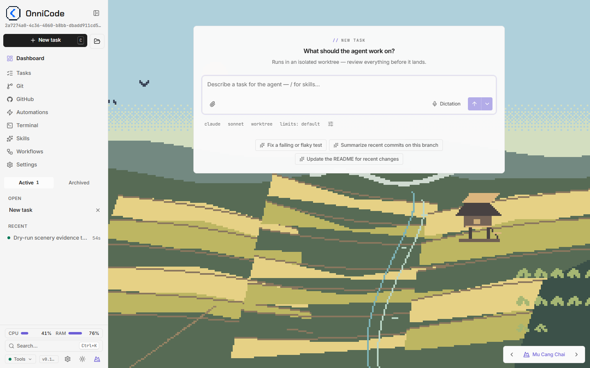

# R7 — Visual Gap Analysis & Per-Scene Quality Blueprint

> **Date:** 2026-11-22  
> **Author:** Antigravity Worker (`1a90542a`, R7 visual gap analysis)  
> **Order Reference:** Root task `2a7274a0`, Scope `docs/design/pixel-scenes/research/R7-gap-analysis.md`  
> **Evidence Inspected:** All 41 PNGs in [`evidence/v2/ui-after/`](../evidence/v2/ui-after/) (32 desktop 1440×900, 6 narrow 390×844, 1 popover, 2 scene sheets), 41 PNGs in [`evidence/v2/ui/`](../evidence/v2/ui/) (pre-fix captures), 8 v1 contact sheets in [`evidence/contact-sheets/`](../evidence/contact-sheets/), and upstream live demo captures in `.ai/onni/tmp-ref/shots/upstream-index.png` and `preview.png` (reference repository: `Aqua2409z/pixel-chat-themes` at commit `f237a18f`).

---

## 1. Executive Summary & Quality Gap Overview

The UI integration fixes executed by the manager (adding the opaque reading panel on `/new`, rendering the 35% Horizon strip in `chat`, and serving real static thumbnails in `ScenePopover`) successfully resolved the blocker bugs where text was illegible or scenes were 100% hidden. However, inspecting the exposed scenery art reveals a severe aesthetic gap when compared directly to the upstream benchmark (`Aqua2409z/pixel-chat-themes`):

1. **Monolithic Flat Polygons vs. Textural Depth:** Upstream uses rich micro-clustering, directional surface shading, and depth occlusion (e.g. the Noel village features distinct roof overhangs, window bevels, and multi-layered snow). In our current scenes, mountains, terraces, and cloud banks are rendered as giant flat polygons with 1 or 2 flat color fills, resembling low-poly vector cutouts rather than hand-crafted pixel art.
2. **Tiny, Unreadable Hero Subjects vs. Confident Visual Anchors:** Upstream builds every scene around a massive, immediately recognizable hero element occupying 30–45% of the frame (e.g. the 40% waving Vietnam flag, the prominent Mount Fuji + Torii gate in Sakura Breeze, or the massive glowing black hole accretion disc in Cosmic Galaxy). In our scenes, key subjects are microscopic (a 15×11px boat in Ha Long, 24px camels in Sahara, a 5×6px pagoda on Fansipan), leaving the composition empty and directionless.
3. **Coarse Bayer Dither Bands vs. Natural Transitions:** Our engine heavily relies on full-width 2×2 and 4×4 Bayer checkerboard dither patterns across skies (Ha Long, Fansipan, Matterhorn, Sahara) and midground features (Sahara heat haze, Kyoto lantern mat). When scaled 3× to 1440×900, these form distracting screen-door grids and moiré artifacts that compete with UI text. Upstream avoids full-sky dither in favor of solid clean steps or soft, bounded radial glows.
4. **Disjointed Reflections & Missing Glow Causality:** Upstream establishes strong cause-and-effect lighting (lanterns cast warm halos that reflect directly onto rippling water; falling snow turns warm yellow inside light cones). Our scenes display disjointed lighting: cabins and suns cast blocky, disconnected rectangular slabs into water (Tromsø, Ha Long, Matterhorn), and lanterns sit on flat checkerboard mats without realistic ambient light spread.
5. **Theme & Palette Mismatches:** Several scenes render bright daylight palettes in dark mode (`vn-mu-cang-chai`, `vn-fansipan`, `vn-sahara`) or dusky dark palettes in light mode (`world-tromso`, `world-kyoto`), destroying atmospheric immersion and time-of-day progression.

---

## 2. Detailed Per-Scene Analysis (8 Scenes)

---

### 2.1. `vn-halong` — Vịnh Hạ Long (Ha Long Bay)

#### A. Visually Wrong vs. Upstream Bar
- **Flat Conical Shapes:** Karst limestone pillars are drawn as smooth geometric cones or cylinders split down the middle with two flat colors (`#3D5F5E` and `#7A9E8D`). They lack the iconic rugged vertical fissures, undercut sea arches, weathered caves, and clinging rainforest vegetation characteristic of Ha Long Bay.
- **Glitch Artifacts & Floating Bars:** 
  - A glaring horizontal chalk-white line cuts across the left karst at `0.48h` (a broken fog/layer bug).
  - Four pitch-black horizontal bars (`0.48h..0.66h`) float on the right karst cliff face, reading as disjointed barcode lines rather than cave openings.
- **Microscopic Hero Subject:** The traditional Vietnamese junk boat is a tiny 15×11 art px speck (barely 3.1% canvas width) floating lost in open water. Its sails are two rigid brown triangles lacking batten ribs, rigging, or presence.
- **Blocky Water Glints:** The water glint path consists of rigid horizontal rectangular slabs (12–32px wide by 2–4px high) stepped down like a staircase rather than organic wave ripples.
- **Coarse Full-Sky Dither:** Sky transitions between pale teal `#A9CDDB` and pale peach `#F3D9B0` using an aggressive full-width Bayer checkerboard band that produces noisy stippling behind UI controls.

#### B. Hero Subject & Target Composition (% Sizes at 480×270)
- **Hero Subject:** Traditional Triple-Batten Fan-Folded Junk Boat (Thuyền buồm Hạ Long) with detailed timber hull, bowsprit, and tapering wake.
- **Target Composition:**
  - **Hero Junk Boat:** Positioned at `u = 0.68..0.80, v = 0.64..0.82`; size **42×32 art px** (8.75% width, 11.85% height). Sits prominently in the right gutter outside the central 760px `/new` card.
  - **Near Limestone Karst (Left Framing):** `u = 0.00..0.20, v = 0.32..1.00` (20% width, 68% height); dramatic vertical cliff with undercut sea base, dark mossy clefts, and overhanging bonsai shrubbery.
  - **Midground Karst Pillar (Right):** `u = 0.76..1.00, v = 0.26..0.72` (24% width, 46% height); faceted limestone crag with deep shadow crevices and sea caves.
  - **Distant Karsts (Atmospheric Horizon):** `u = 0.18..0.88, v = 0.40..0.62`; 4 distinct staggered karst silhouettes fading into morning sea mist.
  - **Waterline / Horizon:** `v = 0.62` (top 62% sky & mountains, bottom 38% water).
  - **Dawn Solar Disc:** Centered at `u = 0.80, v = 0.24`, radius 10px, surrounded by a 24px soft radial gradient halo.

#### C. Target Palette Key Colours (Hex)
- **Light (Dawn):**
  - Sky: `#A2CAD8` (zenith) → `#F2D8B2` (dawn horizon)
  - Limestone Karsts: `#1A3338` (deep crevice), `#38585A` (shadow body), `#6E9486` (lit rock), `#B2C2A0` (sunlit moss rim)
  - Emerald Sea: `#2C5860` (deep water), `#48828A` (mid-tone wave), `#DFCE9E` (dawn glint)
  - Junk Boat: `#8C422D` (fan sail), `#543224` (timber hull), `#D48858` (sail highlight)
- **Dark (Dusk / Twilight):**
  - Sky: `#182238` (deep navy) → `#9E5D66` (dusk magenta)
  - Karsts: `#121E26` (night shadow), `#253740` (body slate), `#6B5452` (warm dusk rim)
  - Bay Water: `#162C3B` (deep indigo water), `#B87E6E` (amber dusk reflection)
  - Junk Boat: `#482824` (hull), `#A45E4C` (warm dusk-lit sail), `#FFAA50` (cabin lantern)

#### D. 5 Most Valuable Fixes (Priority Order)
1. **Eradicate Glitch Lines & Cave Bars:** Delete the 4 black horizontal `Cave` bars on the right cliff and fix the white slice line bug at `0.48h` on the left karst.
2. **Redesign Junk Boat as 42×32px Hero Sprite:** Replace the 15×11px speck with a handcrafted junk sprite featuring ribbed fan-sails, wooden hull texture, a 2-pose sail flutter (2fps), and subtle bobbing (`±1px`, 7s period).
3. **Faceted Limestone Geometry with Overhangs:** Replace conical triangular math shapes with faceted multi-vertex polygons featuring vertical fractures, dark undercut notches (`#1A3338`), and green foliage clusters.
4. **Cohesive Reflection Column & Wavelet Ripple Cycles:** Replace stair-step rectangular glints with 4-phase palette-cycling wave ripples (4–12px length, 1px thickness) forming a tapering vertical reflection column beneath the junk and sun.
5. **Stratified Island Mist Ribbons:** Add 2 low-altitude mist layers (8–14px height, drifting horizontally at `0.2px/s`) masking the bases of the distant karsts to establish true atmospheric depth.

---

### 2.2. `vn-mu-cang-chai` — Mù Cang Chải (Terraced Rice Valley)

#### A. Visually Wrong vs. Upstream Bar
- **Flat Banded Polygons:** The terraced hillsides look like giant cut-out cardboard pieces glued together. Tiers are uniform flat yellow and olive bands with zero texture, no rice stalk stippling, and no soil edge definition.
- **Ladder / Railway Canal Bug:** The irrigation stream is rendered as twin parallel turquoise curves with horizontal white rungs cutting straight down the terraces, resembling a railroad track or vertical ladder rather than flowing water.
- **Toy-Like Matchstick Stilt House:** The H'Mong stilt house is a rudimentary flat brown box perched on 4 stick legs, devoid of thatch eaves, windows, entrance ladder, or shadow grounding.
- **Identical Light/Dark Palette:** Dark mode displays the exact same bright daylight yellow terraces (`#E4CC78`) and light sky as light mode; the palette does not shift to dusk or night.
- **Weak Horizon & Tiny Birds:** Background hills are uniform low bumps; birds in the upper sky are two microscopic 2-line V strokes.

#### B. Hero Subject & Target Composition (% Sizes at 480×270)
- **Hero Subject:** Sweeping S-Curve Rice Terraces cascading down a mountain valley, anchored by an authentic H'Mong Gabled Stilt House (Nhà sàn).
- **Target Composition:**
  - **Cascading Terraces (Midground):** 3 sweeping curvilinear tiers flowing diagonally from upper left (`u = 0.05, v = 0.38`) sweeping down toward lower center (`u = 0.58, v = 0.88`). Terrace step heights increase with perspective: 3px (far) to 14px (near).
  - **H'Mong Stilt House (Scale Anchor):** Positioned at `u = 0.74..0.85, v = 0.54..0.68`; size **36×26 art px** (7.5% width, 9.6% height). Features gabled thatch roof with overhanging eaves, exposed wood porch, timber stilts, and grounding contact shadow.
  - **Meandering Mountain Stream:** Smooth 1–3px bezier curve channel reflecting sky light, winding between terrace dikes from `(0.52, 0.88)` up to `(0.66, 0.52)`.
  - **Layered Distant Ridges:** `u = 0.00..1.00, v = 0.20..0.40`; 2 layered mountain ridges in cool hazy slate blue.
  - **Foreground Rice Cluster (Near Framing):** `u = 0.80..1.00, v = 0.74..1.00`; close-up golden rice stalk tufts swaying gently in the lower-right foreground.

#### C. Target Palette Key Colours (Hex)
- **Light (Golden Harvest Day):**
  - Sky: `#9ECAD8` → `#D2E2BE`
  - Terraces: `#546332` (shadow dike), `#9A9438` (unripe grain), `#D8BA4E` (ripe golden harvest), `#F6E078` (sunlit grain tip)
  - Stilt House: `#4E3B2A` (aged timber), `#7E6040` (weathered thatch), `#3A4E38` (foliage)
  - Stream: `#88B2BC` (sky water reflection)
- **Dark (Mountain Twilight Dusk):**
  - Sky: `#1E263C` (navy) → `#8E5862` (smoky mauve)
  - Terraces: `#283226` (deep hillside shadow), `#585032` (muted olive), `#967A42` (twilight gold)
  - Stilt House: `#241C1A` (silhouette timber), `#FFB048` (warm glowing window lantern)
  - Stream: `#3D4C5E` (deep twilight blue water)

#### D. 5 Most Valuable Fixes (Priority Order)
1. **Scrap Ladder Canal for Meandering Natural Stream:** Eliminate the twin-rail ladder lines with glint rungs; implement a natural 1–3px bezier stream nested inside terrace dikes with localized 4-phase water shimmer.
2. **Redraw Stilt House as Architectural Landmark:** Replace the flat box on sticks with a 36×26px sprite with steep thatch rooflines, wood grain texture, support stilts, and an illuminated amber window in dark mode.
3. **Organic Curvilinear Terraced Geometry:** Replace flat polygon bands with organic contour curves featuring 2px dark soil dikes (`#546332`) and vertical terrace drop-shadows.
4. **Fix Dark Mode Palette Inversion:** Wire true mountain dusk/night palettes so terraces take on deep twilight olive/umber tones and the sky turns deep navy-mauve.
5. **Foreground Swaying Rice & Valley Mist:** Add 8×8px rice tuft sprites in the bottom right corner (2fps subtle sway) and low-altitude mist ribbons drifting through the valley floor.

---

### 2.3. `vn-fansipan` — Fansipan (Peak & Sea of Clouds)

#### A. Visually Wrong vs. Upstream Bar
- **Monolithic Flat Cloud Sea:** The sea of clouds is an enormous, featureless flat cream polygon covering ~65% of the lower canvas with zero billow, volume, or depth.
- **Holes & Polygon Void Artifacts:** Random dark slate triangles and polygons punch through the cloud sea, reading as visual rendering bugs rather than mountain crests.
- **Canvas Truncation Gap Bug:** The cloud layer terminates at `0.96h`, leaving an awkward salmon-pink sky strip exposed at the bottom-right corner.
- **Weak, Generic Summit Silhouette:** Fansipan summit at `(0.70, 0.23)` is drawn as a generic triangular lump outlined with white dashed lines, lacking Fansipan's jagged granite crags, arêtes, and sheer drop-offs.
- **Microscopic Landmark Specks:** The summit pyramid monument and flag are microscopic 5×6px brown dots that get completely lost behind UI controls.

#### B. Hero Subject & Target Composition (% Sizes at 480×270)
- **Hero Subject:** Fansipan Granite Pyramid Summit rising majestically above a Multi-Tiered Billowing Cloud Sea, with authentic stainless steel pyramid monument and waving national flag.
- **Target Composition:**
  - **Fansipan Summit Buttress:** `u = 0.56..0.84, v = 0.15..0.52`; width **134 art px** (~28% width), height **100 art px** (~37% height). Sharp, faceted granite arête with deep slate shadow facets on the west side and warm alpenglow on the east face.
  - **Summit Pyramid & Flag Sprite:** Perched at `(0.68, 0.18)`; size **20×16 art px**; gleaming metallic pyramid landmark with an 8×6px waving red flag with gold star (3-pose animation, 3fps).
  - **Distant Cloud Floor (Far Billows):** `v = 0.42..0.64`; overlapping rounded cloud puffs drifting slowly horizontally (`0.12px/s`).
  - **Foreground Cloud Sea (Near Roll):** `v = 0.60..1.00`; dense cumulus billows with deep blue-slate undersides (`#738598`), cream bodies (`#E8EFF2`), and glowing golden rims (`#FDE0C4`), extending all the way to `1.0h`.
  - **Near Left Mountain Flank (Framing):** `u = 0.00..0.22, v = 0.55..1.00`; craggy granite ridge framing the left gutter.

#### C. Target Palette Key Colours (Hex)
- **Light (Alpine Sunrise Dawn):**
  - Sky: `#9AB3CC` (zenith) → `#F0C4A4` (sunrise horizon)
  - Granite Summit: `#283642` (cleft shadow), `#485D6C` (slate body), `#849BA6` (lit face), `#D4CEBC` (alpenglow rim)
  - Cloud Sea: `#6E8094` (cloud belly shadow), `#ABC0CC` (mid-tone), `#E4ECF0` (cloud puff), `#FDE0C4` (golden dawn rim)
  - Landmark Flag: `#BA3428` (flag red), `#F4D03F` (gold star), `#CBD6DE` (steel monument)
- **Dark (Moonlit High Sierra Night):**
  - Sky: `#0C1828` (indigo night) → `#22354A` (horizon blue)
  - Granite Peak: `#121C26` (deep night slate), `#243644` (moonlit rock), `#5C7488` (silver frost rim)
  - Moonlit Cloud Sea: `#162230` (abyss shadow), `#30445A` (moonlit body), `#6E869C` (silver crest)
  - Landmark Beacon: `#682420` (flag), `#E4B244` (amber summit beacon)

#### D. 5 Most Valuable Fixes (Priority Order)
1. **Extend Cloud Sea to 1.0h & Remove Void Holes:** Eliminate the bottom-right salmon sky gap bug by extending cloud coverage to full canvas height, and remove the polygon void holes punching through the cloud deck.
2. **Multi-Tiered Volumetric Cloud Puff Engine:** Replace the single flat polygon with 2 scrolling layers of scalloped cloud puffs with shaded bellies, rounded tops, and translucent dithered margins.
3. **Redraw Chiseled Granite Summit Crag:** Model Fansipan's authentic pyramidal horn with sharp diagonal arêtes, couloir drop-shadows, and sunlit rock faces.
4. **Authentic Pyramid Monument & Animated Flag Sprite:** Add the iconic 20×16px metallic pyramid landmark with an animated 3-pose waving red flag (`8×6px`) at the summit.
5. **Sunrise Rim Lighting on Crests & Clouds:** Apply crisp 1px peach/amber rim highlights along the eastern mountain ridge and top cloud billows facing the sunrise.

---

### 2.4. `vn-phu-quoc` — Phú Quốc (Tropical Sunset Shoreline)

#### A. Visually Wrong vs. Upstream Bar
- **Detached Floating Frond Stick Bug (`phu-quoc.ts` L181):** A disconnected brown line segment floats in mid-air at `x = 0.09w, y = 0.35..0.39h` due to a broken trunk frond-sway offset.
- **Rigid Matchstick Palms & Spindly Fronds:** Palm trunks are rigid, uniform angled sticks; fronds radiate like thin spider legs without weight, drooping curve, or layered tropical volume.
- **Blocky Water Glint Rectangles:** Sun reflection on the sea consists of giant, chunky rectangular blocks (16–32px wide by 4–8px high) that look like digital glitches rather than glistening wave crests.
- **Flat Stepped Island Silhouette:** The offshore island in the mid-left is a crude, stepped green box lacking organic topography or canopy.
- **Barren Beach Wedge:** The shoreline is a flat diagonal wedge of brown/beige with a few isolated dark dots, missing realistic wave wash foam, wet sand darkening, or coastal texture.

#### B. Hero Subject & Target Composition (% Sizes at 480×270)
- **Hero Subject:** Twin Iconic Leaning Coconut Palms (lush drooping fronds, curved textured trunks) framing Sunset Ocean Shoreline with Fishing Boat.
- **Target Composition:**
  - **Hero Coconut Palm (Curved Trunk):** Base at `(0.12, 1.00)`, curved trunk arcing out to `u = 0.22`, crown centered at `u = 0.28, v = 0.40`; crown size **52×40 art px** (10.8% width, 14.8% height) with lush overlapping drooping fronds.
  - **Secondary Palm:** Base at `(0.04, 1.00)`, curving outward with crown at `u = 0.14, v = 0.46`; crown size **38×30 art px**.
  - **S-Curve Sandy Beach:** Sweeping from `(0.00, 0.72)` curving down to `(0.36, 0.86)` and exiting at `(0.70, 1.00)`.
  - **Traditional Vietnamese Sampan / Coracle Boat:** `u = 0.70..0.78, v = 0.66..0.74`; size **30×18 art px**, featuring wooden hull, canopy, fisherman silhouette, lantern, and gentle bobbing motion (`±1px`, 6s).
  - **Sunset Sun & Glint Path:** Sun at `(0.76, 0.36)`, radius 12px; tapering glint path expanding from 8px wide at horizon (`v = 0.58`) to 56px wide at shore.
  - **Far Island Silhouette:** `u = 0.06..0.44, v = 0.50..0.58`; rounded tropical ridge with layered atmospheric haze.

#### C. Target Palette Key Colours (Hex)
- **Light (Tropical Dawn / Morning Glow):**
  - Sky: `#94C4CE` → `#F2C8A4`
  - Tropical Ocean: `#32707C` (turquoise deep), `#E4CF9C` (dawn glint)
  - Sandy Shore: `#967E60` (wet tide line), `#DCC898` (dry coral sand)
  - Coconut Palms: `#244238` (frond shadow), `#487254` (frond green), `#B29854` (golden rim), `#563E2E` (trunk bark)
- **Dark (Fiery Tropical Sunset / Dusk):**
  - Sky: `#281B38` (deep violet) → `#CE5242` (fiery sunset) → `#F09B4E` (horizon gold)
  - Ocean: `#222442` (indigo water), `#E88046` (warm copper glint)
  - Shoreline: `#463440` (twilight tide line), `#8E6050` (warm sand)
  - Palms: `#181E20` (silhouette trunk), `#22302A` (deep frond), `#D46E3E` (fiery sunset rim light)

#### D. 5 Most Valuable Fixes (Priority Order)
1. **Fix Floating Stick Bug in `phu-quoc.ts` L181:** Remove the rogue disconnected line segment at `(0.09w, 0.35..0.39h)` and bind frond animations strictly to the crown pivot.
2. **Redraw Coconut Palms with Volumetric Drooping Fronds:** Replace thin radial sticks with rich, multi-layered drooping palm fronds (under-shadow, body green, and golden rim highlights).
3. **Tapered Sparkling Water Glint Path:** Replace chunky rectangular glint slabs with a natural 6-phase palette-cycling trapezoidal glint column composed of 1–2px wave sparkles.
4. **Dynamic Shoreline Foam Wash Animation:** Implement a 3-pose shoreline foam edge advancing and receding 1–2px (8s period), with dark wet sand revealed as the wave pulls back.
5. **Authentic Coastal Fishing Sampan & Softened Island:** Upgrade the crude raft into a recognizable wooden coastal fishing boat with lantern glow, and soften the island from a stepped block to lush rolling hills.

---

### 2.5. `world-tromso` — Tromsø (Fjord & Aurora Borealis)

#### A. Visually Wrong vs. Upstream Bar
- **Barcode Aurora Curtains:** Northern lights curtains look like harsh vertical green barcode stripes with crude checkerboard dithering, resembling stiff plastic blinds rather than glowing, translucent plasma curtains.
- **Static Aurora Code Bug:** In v1 code, aurora was drawn once at `build(0)` and remained static; in v2, motion is still mechanical and lacks fluid wave deformation.
- **Detached Orange Slab Reflection:** Cabin window reflection in the fjord is rendered as a vertical stack of disconnected solid orange horizontal rectangles, looking like floating brick steps in the water.
- **Unrefined Daytime Mode:** Light theme daytime rendering simply deletes the aurora, leaving an empty, desolate gray-blue sky without compensating polar cloud dynamics or winter sun effects.
- **No Atmospheric Glow:** Neither the aurora curtains nor the red fisherman's rorbu cabin window cast realistic soft light onto surrounding snow or mountain crags.

#### B. Hero Subject & Target Composition (% Sizes at 480×270)
- **Hero Subject:** Luminous Undulating Aurora Borealis Curtains sweeping over an Arctic Fjord, anchored by a traditional Red Rorbu (Fisherman's Cabin) with glowing amber window.
- **Target Composition:**
  - **Aurora Borealis Drapery (Hero):** `u = 0.16..0.96, v = 0.05..0.46`; 2–3 overlapping sinuous draperies with glowing jade-emerald base (`#52DE9E`), cyan mid-tone (`#34B8A2`), and ethereal magenta/violet upper fringe (`#8A60B4`), undulating smoothly (`0.08 rad/s`).
  - **Red Rorbu Cabin (Scale Anchor):** Positioned at `u = 0.80..0.88, v = 0.63..0.73`; size **28×22 art px** (5.8% width, 8.1% height), deep Falun red timber walls, snow-covered gable roof, wooden pilings, and illuminated warm amber window.
  - **Cabin Water Reflection:** Natural shimmering vertical ripple reflection tapering into the fjord water (`v = 0.73..0.88`), unified with water wavelets rather than detached floating slabs.
  - **Snowy Fjord Mountains:** `u = 0.00..1.00, v = 0.35..0.66`; rugged arctic peaks with blue couloir drop-shadows and moonlit snowfields.
  - **Foreground Snowy Shoreline:** `u = 0.00..0.30, v = 0.75..1.00`; crisp snowbank with 3 wooden mooring pilings and textured sea ice fringe.

#### C. Target Palette Key Colours (Hex)
- **Dark (Polar Aurora Night):**
  - Sky: `#081020` (pitch night) → `#16283E` (horizon navy)
  - Aurora Borealis: `#46E29A` (neon emerald base), `#32B494` (cyan mid), `#885EAA` (violet corona), `#C8FAE2` (ion beam core)
  - Snowy Mountains: `#142030` (shadow granite), `#4A647A` (moonlit snow)
  - Rorbu Cabin & Window: `#78221A` (Falun red), `#FFBA42` (warm glowing window lantern)
  - Fjord Water: `#0E1828` (black water deep), `#266656` (aurora water shimmer)
- **Light (Arctic Winter Day):**
  - Sky: `#A8C4D2` (pale arctic blue) → `#D8DFDC` (hazy horizon)
  - Mountains: `#425668` (granite shadow), `#CEDAE0` (sunlit snow)
  - Fjord: `#46687C` (cold water), `#A2BAC4` (ice reflection)
  - Rorbu: `#84362C` (red timber), `#DCE2E4` (roof snow)

#### D. 5 Most Valuable Fixes (Priority Order)
1. **Sinuous Smooth Aurora Curtain Shader/Algorithm:** Replace vertical barcode dither bands with smooth sinuous undulating drapery curves utilizing 4-level emerald/violet ramp and organic phase displacement (`0.06–0.12 rad/s`).
2. **Organic Water Reflection of Cabin & Aurora:** Re-engineer the cabin window reflection to ripple naturally with horizontal 1px displacement and fade gradually into the water, eliminating the disconnected orange slabs.
3. **Luminous Aurora & Window Halo Effects:** Implement localized radial index lighting around the rorbu window and soft atmospheric diffusion along the lower emerald fringe of the aurora curtains.
4. **Arctic Winter Day Transformation:** Enhance light mode with dramatic low-angle arctic sun glow (`#F6E3B4`), wispy polar stratospheric cirrus clouds, and long blue shadows across the snowfields.
5. **Gentle Animated Polar Snowfall:** Add a 32-particle layered snowfall pool drifting diagonally at 2–5px/s with slight wind gust variation.

---

### 2.6. `world-kyoto` — Kyoto (Fushimi Inari Torii Path)

#### A. Visually Wrong vs. Upstream Bar
- **Foreground Torii Lintel Bisects UI:** The massive foreground Torii gate crossbeam (`kasagi` and `nuki`) runs horizontally at `0.19..0.32h`, directly colliding with and getting obscured behind the `/new` form header and prompt card.
- **Identical Light/Dark Palettes:** Dark mode dusk palette (`#27384B / #924B43`) is mistakenly rendered in light mode; light mode lacks the crisp morning sunbeams, vibrant vermilion red, and fresh green moss required for daylight.
- **Harsh Checkerboard Lantern Glow Bug:** The right stone lantern (`toro`) has a crude, noisy yellow-and-black 2×2 Bayer checkerboard circular mat beneath it (`kyoto.ts` L465–475) that looks like a pixel dither bug rather than soft lantern light.
- **Flat Barren Moss Ground:** The ground to the left of the stone path is a flat, featureless olive-green polygon with 4–5 isolated gray stepping stone squares.
- **Stiff Repetitive Background Gates:** The receding Torii gates down the path lack perspective depth, varied timber shadows, and subtle forest overhangs.

#### B. Hero Subject & Target Composition (% Sizes at 480×270)
- **Hero Subject:** Atmospheric Vermilion Torii Gate Tunnel (Senbon Torii) receding along a Flagstone Forest Path with illuminated Stone Lanterns.
- **Target Composition:**
  - **Foreground Torii Gate Framing:** Elevate the upper crossbeam to `v ≤ 0.10` or clear the central span so the `/new` reading card sits cleanly framed; side pillars positioned at `u = 0.15..0.21` (left) and `u = 0.89..0.95` (right), providing clean vertical framing without UI bisection.
  - **Receding Torii Tunnel (Perspective):** Vanishing point at `(0.68, 0.46)`; 4 distinct diminishing gates (widths: 56px, 34px, 20px, 12px) creating deep linear perspective.
  - **Flagstone Path:** `u = 0.52..0.82` (foreground base) tapering to `u = 0.66..0.70` (horizon path end); textured stone pavers with mossy joints.
  - **Carved Stone Lantern (Tōrō):** Positioned at `u = 0.82..0.90, v = 0.68..0.80`; size **18×30 art px** carved granite lantern with softly stepped radial amber illumination (smooth 3-tier ramp, no checkerboard).
  - **Lush Mossy Forest Floor:** `u = 0.22..0.52, v = 0.50..1.00`; undulating moss mounds with fern tufts, bamboo stems, and scattered fallen maple leaves (`momiji`).

#### C. Target Palette Key Colours (Hex)
- **Light (Morning Bamboo Forest / Dawn):**
  - Sky: `#CCDED6` (misty bamboo sky)
  - Torii Vermilion: `#722A24` (shaded timber), `#C2442E` (vibrant vermilion red), `#EC6E46` (morning sunlit edge)
  - Forest & Moss: `#364E34` (deep cedar forest), `#567442` (mossy knoll), `#8CA862` (fresh moss highlight)
  - Stone Path: `#6E716E` (slate pavers), `#AAAEA6` (highlight stone)
- **Dark (Cryptomeria Twilight / Dusk):**
  - Sky: `#1A2434` (deep forest dusk)
  - Torii: `#421A16` (shadowed lacquered wood), `#883022` (dusky crimson), `#C8563A` (lantern-lit wood)
  - Forest: `#121E18` (pitch forest abyss), `#26362A` (deep cypress moss)
  - Lantern & Light: `#FFC64E` (warm candle flame), `#DE9030` (amber flagstone glow)

#### D. 5 Most Valuable Fixes (Priority Order)
1. **Reposition Foreground Torii Kasagi to Clear UI:** Shift the upper crossbeam upward to `v ≤ 0.10` so the `/new` form card does not collide with the main lintel.
2. **Eliminate Checkerboard Lantern Glow:** Replace the 2×2 Bayer dither circle with a smooth 3-stage concentric radial luminance ramp (`#FFC64E → #DE9030 → transparent`) cast naturally across path stones.
3. **Wire Proper Light/Dark Forest Palettes:** Provide distinct crisp daylight bamboo palette (vermilion `#C2442E`, fresh moss `#567442`) separate from the moody twilight dusk palette.
4. **Add Foliage Detail & Texture to Mossy Forest Floor:** Replace the flat green slab with layered moss mounds, fern sprigs, bamboo culms, and fallen red/gold maple leaf clusters.
5. **Animated Drifting Maple Leaves (Momiji):** Add a subtle 12-particle pool of red Japanese maple leaves drifting gently down the stone path (1.5–3px/s drift with slight flutter rotation).

---

### 2.7. `world-matterhorn` — Matterhorn (Alpine Peak & Lake Riffelsee)

#### A. Visually Wrong vs. Upstream Bar
- **Summit Hidden Behind UI Card:** The iconic hooked pyramid summit of the Matterhorn is situated at `(0.70, 0.17)`, which sits directly behind the central `/new` form card, hiding the primary landmark of the scene.
- **Barcode Lake Reflection:** Reflection in Lake Riffelsee consists of severe horizontal dither bands with dashed white/light-blue rectangular bars (barcode grid look) rather than organic water reflection.
- **Coarse Horizontal Sky Dither:** Full-width horizontal Bayer checkerboard bands stretch across the sky, creating artificial visual noise.
- **Repetitive Stamp Pines:** Pine trees lining the lake are identical triangular stamps with no variation in height, foliage volume, or snow dusting.
- **Disjointed Cabin & Flat Shores:** The alpine chalet is plunked squarely in the middle with a stiff 1px zigzag smoke line, and the lake shoreline is a flat, untextured olive rim.

#### B. Hero Subject & Target Composition (% Sizes at 480×270)
- **Hero Subject:** Dramatic Hooked Chiseled Pyramid Peak of the Matterhorn reflected in pristine Alpine Lake Riffelsee with Larch Pine Forest.
- **Target Composition:**
  - **Offset Matterhorn Summit:** Reposition summit peak to `u = 0.78, v = 0.14` (clearing the central 760px `/new` card so the iconic hooked horn rises cleanly in the right gutter); peak dimensions: width **120 art px** (~25% width), height **110 art px** (~40% height), sharply defined chiseled Zmutt/Hörnli ridges.
  - **Alpine Lake Riffelsee:** `u = 0.00..1.00, v = 0.62..0.92`; tranquil alpine tarn with realistic mountain reflection broken by delicate horizontal wind ripples.
  - **Larch & Stone Pine Forest:** `v = 0.54..0.66`; 3 varied pine tree models (tall larch 28px, bushy Swiss stone pine 20px, young pine 14px) with frosted snow rims.
  - **Alpine Meadow & Glacial Moraine (Near):** `u = 0.00..0.28` and `u = 0.88..1.00, v = 0.76..1.00`; rugged granite boulders, alpine grass, and snow patches.
  - **Alpine Chalet / Cabin:** `u = 0.72..0.78, v = 0.58..0.64`; cozy wooden chalet with heavy stone roof, soft window glow, and volumetric curling chimney smoke.

#### C. Target Palette Key Colours (Hex)
- **Light (Alpine Morning Alpenglow / Dawn):**
  - Sky: `#9EBECF` → `#ECC8B0`
  - Matterhorn Rock: `#384250` (dark north face), `#647284` (shadow slate), `#ACA094` (sunlit horn), `#EEE4D8` (alpenglow snow crest)
  - Alpine Lake: `#3E647C` (deep alpine blue), `#DEC8BA` (peach peak reflection)
  - Pines: `#243C36` (forest shadow), `#466250` (larch needles)
- **Dark (Moonlit Starlight Matterhorn / Night):**
  - Sky: `#0A1424` (deep cobalt) → `#1A2E44` (horizon blue)
  - Peak: `#141C28` (shadow granite), `#2E3E50` (slate ridge), `#748C9E` (moonlit snow fields), `#C8D8E6` (glacial rim)
  - Pines: `#0E1A18` (dark silhouette), `#243630` (moonlit boughs)
  - Lake: `#101C2A` (inky lake), `#3C5A72` (silvery moonlit mountain reflection)

#### D. 5 Most Valuable Fixes (Priority Order)
1. **Reposition Summit Horn to Right Gutter (`u = 0.78`):** Shift the peak summit horizontally away from the center so the iconic Matterhorn hook remains dramatically visible in `/new` desktop mode.
2. **Natural Mountain Lake Water Reflection:** Replace the barcode grid of dither dashes with an authentic inverted mountain reflection warped by subtle sinusoidal water ripples (1px vertical jitter, 3fps phase).
3. **Chiseled Ridge Geology & Alpenglow Shading:** Replace flat polygon faces with chiseled rock strata, dramatic couloir drop-shadows, and sunlit snowfields.
4. **Multi-Model Alpine Pine Forest:** Replace identical stamp trees with 3 handcrafted sprite variations (varying heights, branches, and snow caps) clustered naturally along the moraine.
5. **Volumetric Curling Smoke & Soft Cabin Glow:** Upgrade the 1px zigzag smoke line to a multi-particle puff sprite (12×12px, 4-pose drift, expanding upwards) with a warm amber window glow.

---

### 2.8. `world-sahara` — Sahara (Desert Erg & Caravan)

#### A. Visually Wrong vs. Upstream Bar
- **Harsh Checkerboard Heat-Haze Ribbon Bug:** A stark, horizontal 2×2 Bayer checkerboard dither ribbon (`bandTop..bandBot`) cuts straight across the middle dunes, looking like an ugly screen glitch.
- **Camels Too Small & Camouflaged in Dark Mode:** The 3-camel caravan consists of tiny figures (24px, 17px, 12px) whose dark purple silhouette in dark mode blends invisibly into the dark shadow slip-face.
- **Repetitive Wave-Dune Topography:** Distant dunes look like simple repeated sine-wave ripples with uniform wavelength, lacking dramatic windblown desert scale.
- **Coarse Horizontal Sky Dither:** Noticeable stepped dither bands across the sky transition.
- **Empty Foot Trails & Flat Slip Faces:** Camel footprints are merely a few disconnected pixel dots; the transition between windward sand and slip-face is sharp but lacks windblown crest sand-drift plumes.

#### B. Hero Subject & Target Composition (% Sizes at 480×270)
- **Hero Subject:** Sweeping Windblown Crescent Erg / Star Dune S-Curve with Prominent Silhouetted Camel Caravan and Drifting Sand Plume.
- **Target Composition:**
  - **Monumental Crescent S-Curve Dune:** Dominant slip-face sweeping from lower-left `(0.18, 0.94)` curving up to crest knife-edge at `(0.58, 0.54)` and extending to `(0.94, 0.64)`, dividing golden sunlit sand from deep violet slip-face shadow.
  - **Camel Caravan (Hero):** 3 camels + leader silhouette walking along the crest; lead camel at `(0.70, 0.58)`, size **32×22 art px** (6.7% width, 8.1% height); 2nd camel 24×16 px; 3rd camel 18×12 px; leader figure leading with rope. High visual contrast against the sky/sand boundary.
  - **Winding Caravan Trail:** Curved depression trail with footprint clusters (`3–5px` paired depressions with shadow wells) meandering back along the dune ridge.
  - **Windblown Sand Plume:** Dynamic sand wisps blowing off the sharp crest ridge (`0.58..0.85u`), 1px particle drift (4–8px/s).
  - **Distant Erg Dune Ridges:** `u = 0.00..1.00, v = 0.34..0.52`; layered atmospheric desert dunes fading into heat shimmer haze.
  - **Desert Sun / Moon:** Sun at `(0.24, 0.22)`, radius 11px, blazing desert dawn/day core with wide warm atmospheric wash.

#### C. Target Palette Key Colours (Hex)
- **Light (Golden Desert Heat Day):**
  - Sky: `#A0C0CC` (desert blue) → `#E4CEAE` (dust horizon)
  - Sunlit Dune Sand: `#DCA45C` (golden sand body), `#F0CE8A` (blazing sunlit crest)
  - Slip-Face Shadow: `#664050` (rich mauve-purple shadow), `#945E64` (warm ambient shadow)
  - Camels: `#3A1E1C` (dark leather/fur silhouette), `#945C3E` (lit saddle blanket)
- **Dark (Saharan Twilight / Starlight Dusk):**
  - Sky: `#141828` (indigo sky) → `#743E4E` (crimson dusk)
  - Dune Highlights: `#BE784E` (cooling terracotta crest)
  - Dune Shadow: `#261828` (deep plum night sand), `#362234` (ambient shadow)
  - Camels: `#100A14` (sharp black silhouette outlined by `#D08860` rim), `#FF843E` (warm caravan lamp)

#### D. 5 Most Valuable Fixes (Priority Order)
1. **Eliminate Checkerboard Heat-Haze Ribbon:** Remove the horizontal 2×2 Bayer dither band across the mid-dunes; replace with a subtle, non-intrusive 2-step atmospheric color transition.
2. **Enlarge & Silhouette-Contrast Camel Caravan:** Scale up lead camel to 32×22 px with rider/leader sprite; in dark mode, give camels an amber rim-light highlight (`#D08860`) so they pop against the dark purple sand.
3. **Dynamic Windblown Sand Drift Particle System:** Add a localized 24-particle pool drifting off the knife-edge crest at 4–8px/s, capturing the iconic Saharan desert wind motion.
4. **Organic S-Curve Dune Topography:** Redraw dune crests with varied wind-sculpted contours, undulating slopes, and realistic concave/convex slip faces.
5. **Meandering Footprint Trail with Depth Shading:** Render an organic path of paired oval camel footprints with dark shadow wells leading back into the distance along the ridge.

---

## 3. Cross-Cutting Engine & Style Issues

### 3.1. Dither Use: Bayer Mesh Abuse vs. Organic Transitional Stippling
- **Current Defect:** The engine systematically overuses full-screen or broad horizontal 2×2 and 4×4 Bayer checkerboard dither patterns (`ctx.dither`) for sky gradients, cloud fills, and atmospheric haze. When upscale-projected onto a desktop viewport (1440×900, 3× scale), each dither unit becomes a prominent 3×3 physical pixel block. This creates an unappealing screen-door grid that produces severe moiré behind transparent reading panels.
- **Upstream Pattern:** Upstream (`claude-pixel-themes.user.js` and Noel's `nxPaint`) strictly confines dithering to 1–2 art-pixel boundary fringes (transitional dithering) between distinct color ramps, or relies on clean solid posterized steps. Large areas (sky, water expanses) are kept as solid clean bands or smooth radial gradients.
- **Engineering Prescription:**
  1. Restrict `ctx.dither` to a maximum width of 4–8 art pixels along palette transition frontiers.
  2. For skies, use 4 clean stepped solid bands; do not dither the full sky height.
  3. Replace mathematical checkerboards on natural materials with directional stippling clusters (e.g. horizontal striae on water, diagonal grain on sand dunes, organic fissures on rock).

### 3.2. Resolution & Scale: 480×270 Art Buffer vs. Viewport Letterboxing & Cropping
- **Current Defect:** The engine renders to a fixed internal art buffer of 480×270 (16:9 aspect ratio). On standard desktop displays (1440×900, 16:10 aspect ratio), CSS `object-fit: cover` vertically crops 30 art pixels (11% of the scene height) off the top and bottom. On portrait mobile viewports (390×844, 9:19.5 aspect ratio), horizontal cropping cuts away over 70% of the canvas, hiding the hero subjects positioned in the gutters.
- **Upstream Pattern:** Upstream dynamically computes its cell grid (`cols × rows`) based on the client container's live aspect ratio while keeping the cell size pinned (11px or 14px), guaranteeing that the focal area is always framed within the visible window.
- **Engineering Prescription:**
  1. Enforce `SceneDef.focus` bounding: ensure that the `focus` coordinate (e.g. `(0.73, 0.70)` for Ha Long Junk, `(0.78, 0.14)` for Matterhorn peak) is clamped inside the visible gutter safe area (`u = 0.65..0.95` on `/new`, and `v = 0.60..0.95` on `chat`).
  2. On narrow viewports (<640px), clamp the hero subject's horizontal offset towards the center or display a specialized 240×300 portrait crop.

### 3.3. Cell Look & Aesthetic Hierarchy: Flat Poly Vectors vs. Authentic Pixel Art
- **Current Defect:** The current scenes occupy an awkward "uncanny valley": they are rendered via Canvas2D polygon fills that produce smooth diagonal vector edges, but lack the deliberate pixel cluster anatomy, black outline definition, or hand-pixeled charm of retro 16-bit pixel art.
- **Upstream Pattern:** Upstream commands attention through bold, stylized silhouettes:
  - Strong value contrast between foreground, midground, and background.
  - Large, expressive character/landmark sprites with distinct palettes.
  - Directional lighting and localized radial luminance (glowing lanterns, shimmering ion beams, glowing snow cones).
- **Engineering Prescription:**
  1. Quantize all vector polygon vertices strictly to whole art-pixel coordinates (`Math.round`).
  2. Implement localized radial index lighting (`litLut[level][index]`) for point light sources (cabin windows, lanterns, suns) rather than drawing flat circular discs.
  3. Ensure every scene has a strict 3-tier visual hierarchy: 1 Hero Subject (occupying ≥7% canvas area), 2 Secondary Environmental Anchors, and clean negative space.

---

## 4. Implementation Priority Matrix

| Priority | Scene / Component | Primary Defect to Fix | Target Impact | Complexity |
| :---: | :--- | :--- | :--- | :---: |
| **P1** | `vn-fansipan` | Fix 0.96h bottom gap bug, delete void holes, build volumetric cloud puff engine | High | Med |
| **P1** | `world-tromso` | Replace barcode aurora with smooth undulating sinuous curtains; fix floating cabin reflection | High | High |
| **P1** | `vn-halong` | Remove cave bars & white slice line; upgrade junk boat to 42×32px hero sprite | High | Med |
| **P1** | `world-kyoto` | Move torii lintel up to clear `/new` card; eliminate checkerboard lantern glow | High | Med |
| **P2** | `vn-phu-quoc` | Fix L181 floating stick bug; redraw palm crowns with volumetric fronds & wave foam | High | Med |
| **P2** | `world-matterhorn`| Reposition peak to right gutter (`u=0.78`); replace barcode lake reflection | High | Med |
| **P2** | `vn-mu-cang-chai` | Scrap railway ladder canal; redraw stilt house; wire dark mode dusk palette | Med | Med |
| **P2** | `world-sahara` | Remove checkerboard heat haze; scale & rim-light camel caravan for dark mode | Med | Low |
| **P3** | Cross-Cutting Engine | Restrict `ctx.dither` to narrow edges; add localized radial index lighting | High | High |

---
*End of R7 Visual Gap Analysis.*
